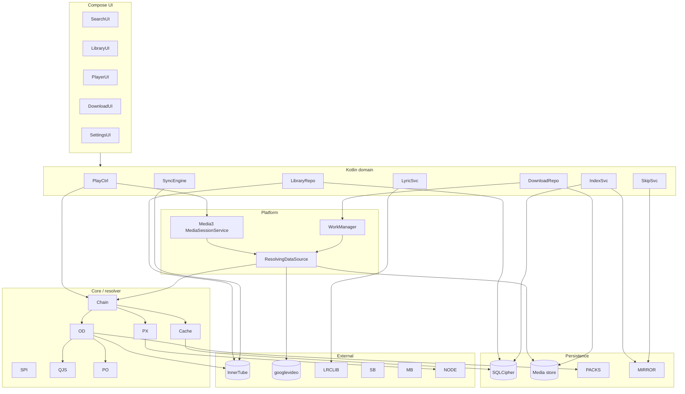
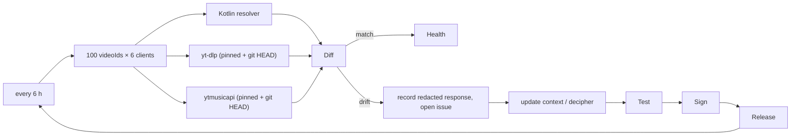
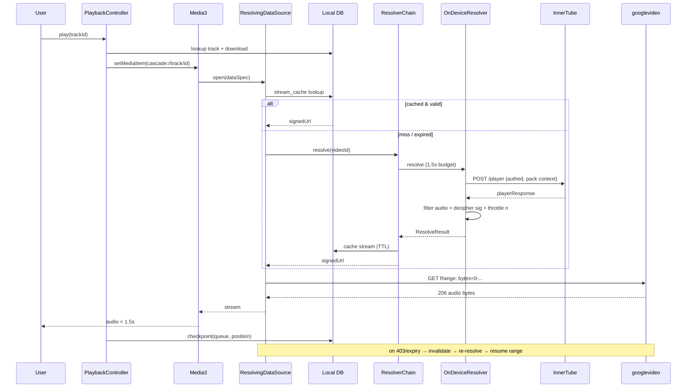
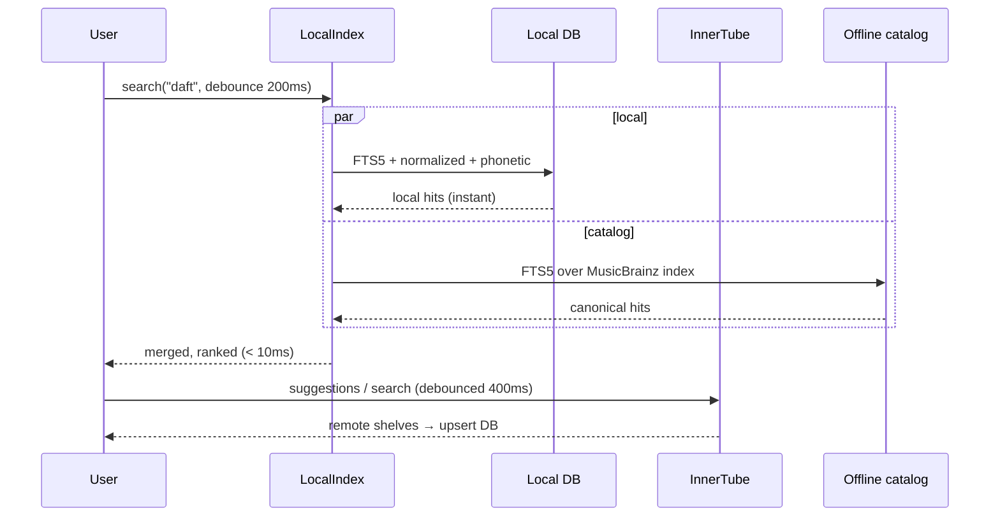
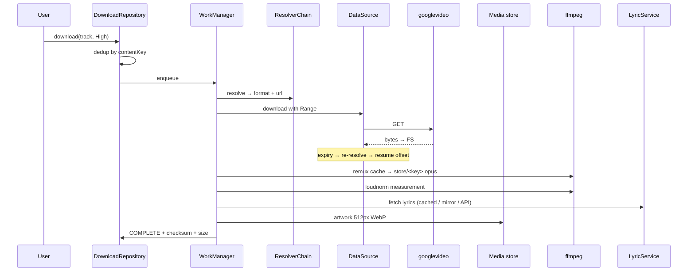
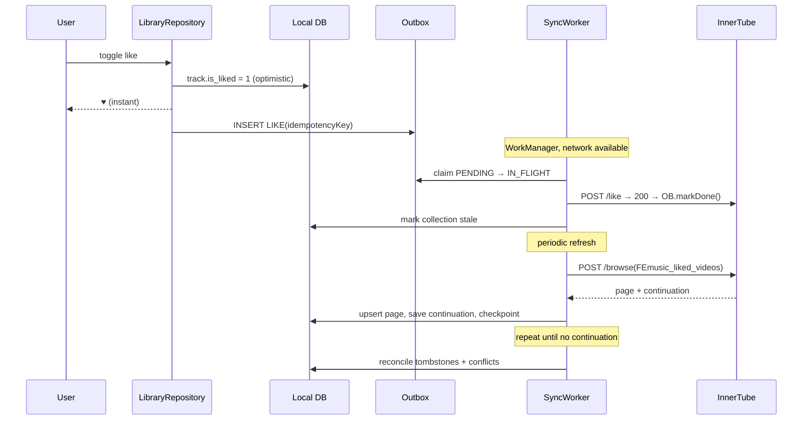

# PROJECT CASCADE — Unified Architecture (Android-First)

## A complete, implementation-ready architecture for a first-class, offline-first YouTube Music client

**Target platform:** Android 8.0+ (API 26)
**Reference lineage:** OuterTune ← InnerTune ← ViMusic; NewPipeExtractor; yt-dlp; ytmusicapi
**Core promise:** Search → play → download → offline → sync, with no server in the critical path and no paid dependency anywhere.

---

# 0. Architecture charter

## 0.1 The five invariants

| # | Invariant | Consequence |
|---|---|---|
| **I1** | **The device is the primary resolver.** | No backend required to play, search, download, or sync. |
| **I2** | **Extractors are data, not code.** | YouTube changes absorbed by a signed, remotely delivered *pack*. |
| **I3** | **Local-first, always.** | Every UI action succeeds against the local database. |
| **I4** | **Only public metadata is shareable.** | Stream URLs are session- and IP-bound; never cached in a shared layer. |
| **I5** | **Identity is a published constant, not a runtime disguise.** | Client identity lives in a signed pack; resilience comes from modularity and fallback. |

## 0.2 Three trust zones

```
┌─────────────────────────────────────────────────────────────┐
│ ZONE 1 — DEVICE (always trusted)                            │
│   Cookies / OAuth tokens    ← never leave                   │
│   Library DB (SQLCipher)    ← never leave                   │
│   Downloaded media          ← never leave                   │
│   InnerTube transport, QuickJS decipher, Media3 player      │
│   → resolves ~95% of playback directly                      │
└──────────────────────────┬──────────────────────────────────┘
                           │ videoId only
                           ▼
┌─────────────────────────────────────────────────────────────┐
│ ZONE 2 — OWN RESOLVER (optional, user-operated)             │
│   FastAPI + yt-dlp OR Piped-Backend; range-proxy            │
│   → may receive cookies ONLY if user opts in and node       │
│     is on user's own hardware                               │
└──────────────────────────┬──────────────────────────────────┘
                           │ videoId only
                           ▼
┌─────────────────────────────────────────────────────────────┐
│ ZONE 3 — COMMUNITY RESOLVER (opt-in, untrusted)             │
│   Federated Piped / Invidious nodes, signed registry        │
│   → anonymous guest resolution only; no cookies             │
└─────────────────────────────────────────────────────────────┘
```

**The library never goes through Zones 2 or 3.**

## 0.3 System diagram



## 0.4 Provenance and pinning

Every third-party component imported at a **pinned commit**, recorded in an SBOM (`cyclonedx` JSON), license verified at import time. CI fails if any dependency's SPDX identifier is not in the allowed set: `Apache-2.0, MIT, BSD-2/3-Clause, ISC, GPL-2.0/3.0, AGPL-3.0, LGPL-2.1/3.0, MPL-2.0, Unlicense, CC0-1.0`. AGPL components used only as separately deployed servers.

---

# A. Stream extraction and playback

## A.1 Audio-only is a *selection* problem

YouTube Music already serves audio-only adaptive formats. There is no video track to remove.

```
candidates = adaptiveFormats.filter { it.mimeType.startsWith("audio/") }
candidates += formats.filter { it.isAudioOnly }
rank(candidates) by:
    codec preference   (opus > aac > vorbis > mp4a-low)
    bitrate descending
    container decodability on this device
    range support
    presence of a resolvable signature
select top 1
```

No ffmpeg. No re-encoding. No demux. The selected URL is a directly playable, range-addressable Opus-in-WebM or AAC-in-MP4 stream. **This is what OuterTune, InnerTune, and ViMusic actually do.**

Demuxing only needed for: legacy progressive-only uploads, and explicit "extract audio from this music video." Both handled by a remux path off the hot path.

## A.2 Reference implementation survey

| Project | URL | License | What to take |
|---|---|---|---|
| **OuterTune** | https://github.com/ddnexus/OuterTune | GPL-3.0 | Product shape; MediaSessionService split; download queue UX; lyrics timeline |
| **InnerTune** | https://github.com/z-huang/InnerTune | GPL-3.0 | The `innertube` Kotlin library boundary |
| **innertube (Kotlin)** | https://github.com/z-huang/innertube | GPL-3.0 | Port to KMP as seed of `:core:innertube` |
| **ViMusic** | lineage note | GPL-3.0 | Historical confirmation of InnerTube approach |
| **NewPipe** | https://github.com/TeamNewPipe/NewPipe | GPL-3.0 | Download scheduler; SponsorBlock contract |
| **NewPipeExtractor** | https://github.com/TeamNewPipe/NewPipeExtractor | LGPL-3.0 | Deobfuscation architecture; `YoutubeSignatureThrottlingExtractor` |
| **yt-dlp** | https://github.com/yt-dlp/yt-dlp | Unlicense | `jsinterp.py` semantics; format selection language |
| **yt-dlp-ejs** | https://github.com/yt-dlp/yt-dlp-ejs | Unlicense | PO-token plugin boundary |
| **ytmusicapi** | https://github.com/sigma67/ytmusicapi | MIT | Wire-protocol spec; endpoint map; OAuth reference |
| **YouTube.js** | https://github.com/LuanRT/YouTube.js | MIT | Response type model; session lifecycle |
| **Piped-Backend** | https://github.com/TeamPiped/Piped-Backend | AGPL-3.0 | Range-proxy design; instance-health model |
| **Invidious** | https://github.com/iv-org/invidious | AGPL-3.0 | Second independent fallback resolver |

**Lineage:** ViMusic and InnerTune share ancestry; maintainable descendants are InnerTune and OuterTune. Follow the `innertube` Kotlin library, not the app forks.

## A.3 On-device resolver

### Kotlin InnerTube transport + QuickJS decipher host

- **URL:** `:core:innertube` (seeded from innertube) + QuickJS (https://github.com/bellard/quickjs)
- **License:** Apache-2.0 (own code); MIT (QuickJS)
- **Why:** No Python/Node runtime. QuickJS ~600 KB native, starts in microseconds. Decipher fragment 2–10 KB JS, <1 ms. VM ships in APK; only JS is remote.
- **Integration:**
  1. Build QuickJS via CMake for `arm64-v8a`, `armeabi-v7a`, `x86_64`.
  2. Expose JNI surface: `JsHost.load(moduleId, source)`, `.call(moduleId, fn, args)`, `.close()`.
  3. Load pack's `decipher.js` at startup; exports `signature(s)` and `throttle(n)`.
- **Limits:** If QuickJS lacks features, pack ships a WASM module; wasm3 (MIT) runtime in base binary handles it. Do not execute whole player JS — extract only cipher function.
- **Fallback:** `ProxyResolver` (§A.6) + canary publishes new pack.

### Resolver pipeline

```
ResolveRequest(videoId, kind, formatPolicy, accountRef)
  │
  ├─1. StreamCache.lookup(videoId, formatPolicy, accountRef)
  │     valid if now < expiresAt - 120s
  │     AND packVersion == currentPackVersion AND accountId matches
  │
  ├─2. SingleFlight coalescing (N callers → 1 request)
  │
  ├─3. InnerTube POST /youtubei/v1/player
  │     context = pack.clientContexts[WEB_REMIX]
  │     auth    = account.cookieJar (Zone 1 only)
  │     headers = SAPISIDHASH + X-Goog-Visitor-Id
  │
  ├─4. Response classification
  │     "OK" → continue; "LOGIN_REQUIRED" → upgrade client
  │     "AGE_VERIFIED" → requires session; "UNPLAYABLE" → mark; "ERROR" → next
  │
  ├─5. Filter audio-only adaptiveFormats
  │
  ├─6. For each candidate:
  │     if signatureCipher: s = js.signature(cipher.s); url = base + "&" + sp + "=" + s
  │     if url has &n=: n' = js.throttle(n); url = url.replace("&n="+n, "&n="+n')
  │     if PO required and available: url += "&pot=" + potToken
  │
  ├─7. Optional range probe: GET url, Range: bytes=0-0 → expect 206
  │
  └─→ ResolveResult(formats, expiresAt, chapters, warnings)
      → StreamCache.put(...)
```

## A.4 Two JavaScript problems

### Problem 1 — Signature and throttling decipher (small, deterministic)

The player response gives a `signatureCipher`: `{s, sp, url}`. `s` is permuted. The `n` param on media URLs is throttled. **Extraction method (yt-dlp approach):**

1. Fetch watch page HTML; extract `PLAYER_JS_URL` from `ytcfg.set({...})`.
2. Download player JS; cache by URL hash in `filesDir/player-js/`.
3. Locate signature function: find string literal `signature` near `.split("")` / `.reverse()` / `.splice()` pattern.
4. Extract only that function plus its helper closure (2–8 KB).
5. Rewrite helper references into self-contained module exporting `signature(s)`.
6. Same for `n` transform function.

**Validation oracle:** run yt-dlp on same `videoId` with `--dump-single-json`; compare URL params. CI does this for 100 fixtures on every pack change.

**References:**
- `yt_dlp/jsinterp.py` — complete JS-subset interpreter (~700 lines). **Port to Kotlin to eliminate native dependency.**
- NewPipe `DeobfuscationParser`, `DeobfuscationImpl` — Java equivalent.

**Recommendation:** ship two backends behind `Decipher`: `QuickJsDecipher` (fast) and `KotlinJsInterpDecipher` (pure Kotlin fallback, no native code, works on JVM). Pack declares which it needs.

### Problem 2 — Proof of Origin (PO) tokens (large, opaque)

PO token produced by player's proof-of-origin runtime (BotGuard). **Treat as opaque plugin.**

#### bgutil-ytdlp-pot-provider

- **URL:** https://github.com/Brainicism/bgutil-ytdlp-pot-provider
- **License:** record SPDX at pinned commit in SBOM
- **Integration:**
  ```kotlin
  interface PotProvider {
      val capabilities: Set<PotCapability>
      suspend fun token(ctx: PotContext): PotToken?
  }
  ```
  1. **On-device:** QuickJS/WASM pack in isolated `JsHost`, 3s timeout, no network.
  2. **Server-side:** sidecar behind `POST /v1/pot` on own-resolver.
  3. **Cache:** keyed by `(accountId, sessionId)`, TTL from `expiresAt`, refresh at 80%.
  4. **Graceful degradation:** null/timeout → resolver chain continues.
- **Limits:** 1–3 MB runtime. Ship in APK as asset, update rarely.
- **Fallback:** self-hosted → community → authed on-device without PO → "resync needed" retry.

**Critical:** PO generation is never on playback critical path. 1.5s budget for entire on-device attempt. If PO not cached, skip and try next client.

## A.5 Resolver SPI and client matrix

```kotlin
interface Resolver {
    val id: String
    val priority: Int
    val capabilities: Set<Capability>
    val trust: TrustZone
    suspend fun resolve(req: ResolveRequest): ResolveResult
}

enum class Capability { SIGNATURE, THROTTLE, PO_TOKEN, AGE_RESTRICTED,
                        MEMBERS_ONLY, LIVE, PODCAST, UPLOAD }
enum class TrustZone { DEVICE, OWN_NODE, COMMUNITY_NODE }

interface ResolverPack {
    val version: PackVersion
    val minAppVersion: Int
    val clientContexts: Map<ClientId, ContextTemplate>
    val searchParams: SearchParamTable
    val browseIds: BrowseIdTable
    val selectors: ResponseSelectors
    val decipher: DecipherDescriptor
    val potProvider: PotProviderDescriptor?
    val fixtures: List<FixtureRef>
}
```

### Client matrix (pack entries, not hardcoded)

| ClientId | `clientName` | Typical use | Auth | PO needed |
|---|---|---|---|---|
| `WEB_REMIX` | `WEB_REMIX` | **Primary for Music** | Cookies / OAuth | Sometimes |
| `WEB` | `WEB` | Fallback player | Cookies optional | Often |
| `ANDROID` | `ANDROID` | Fallback player | None or session | Varies |
| `IOS` | `IOS` | Fallback player | None | Varies |
| `TV_EMBEDDED` | `TVHTML5_SIMPLY_EMBEDDED_PLAYER` | Fallback | None | Varies |
| `MWEB` | `MWEB` | Mobile web fallback | Cookies | Varies |
| `ANDROID_YT_MUSIC` | `ANDROID_YT_MUSIC` | Music-specific mobile | Session | Varies |
| `IOS_YT_MUSIC` | `IOS_YTMUSIC` | Music-specific iOS | Session | Varies |

**Chain order (device):**
```
WEB_REMIX (authed, cached PO)
  → WEB_REMIX (authed, no PO)
  → ANDROID (guest)
  → IOS (guest)
  → TV_EMBEDDED (guest)
  → OWN_NODE
  → COMMUNITY_NODE (opt-in)
```

Per-cause circuit breaker: if `WEB_REMIX` returns `PO_REQUIRED` 3× in 60s, skip for 5 min, go to `ANDROID`.

## A.6 Fallback resolvers

#### yt-dlp as server-side resolver

- **URL:** https://github.com/yt-dlp/yt-dlp — **License:** Unlicense
- **Why:** updated within hours of YouTube changes by large maintainer team.
- **Integration:** ~200-line FastAPI wrapper (MIT):
  ```python
  ydl_opts = {
      "quiet": True, "no_warnings": True, "skip_download": True,
      "extractor_args": {"youtube": {
          "player_client": ["web_remix", "android", "ios"],
          "po_token": ["web+<token>"] if token else [],
      }},
      "format": "bestaudio[acodec=opus]/bestaudio/best",
      "socket_timeout": 10, "retries": 2,
  }
  ```
- **Limits:** no tool ceiling; upstream + node IP are the ceilings. Remove by federation (§H.6).
- **Fallback:** Piped-Backend → Invidious.

#### Piped-Backend

- **URL:** https://github.com/TeamPiped/Piped-Backend — **License:** AGPL-3.0
- **What:** Java/Spring wrapping NewPipeExtractor. `/streams/{id}`, `/api/...` proxies bytes with Range.
- **Integration:** run in Docker; point `ProxyResolver` at `/streams/{id}`; use its media proxy to eliminate IP-binding.
- **Fallback:** Invidious → own yt-dlp.

#### Invidious

- **URL:** https://github.com/iv-org/invidious — **License:** AGPL-3.0
- **What:** Crystal frontend. `GET /api/v1/videos/{id}` returns `adaptiveFormats`, `formatStreams`, `chapters`.
- **Fallback:** Piped-Backend.

**Scope limit:** Piped/Invidious are **YouTube** frontends. Resolution fallbacks only. Music library always device → InnerTube.

## A.7 Python on Android

| Option | License | Bundle | Startup | Verdict |
|---|---|---|---|---|
| Chaquopy | Not free-software for all uses | 15–25 MB | 200 ms | **Rejected** |
| python-for-android | MIT | 25–40 MB | 400 ms | Viable secondary |
| nodejs-mobile | Apache-2.0 | 15–20 MB | 80 ms | Viable |
| **QuickJS** | MIT | 0.6 MB | <1 ms | **Selected primary** |
| **Pure Kotlin port** | Apache-2.0 | 0.3 MB | <1 ms | **Selected core** |
| Termux/proot | GPL-3.0 | 80 MB+ | 1 s | Rejected |

**Decision:** Kotlin core + QuickJS decipher. yt-dlp lives on the server. Optional on-device yt-dlp module (M10, python-for-android) never in base APK.

## A.8 SponsorBlock and segment skipping

#### SponsorBlock

- **URL:** https://github.com/ajayyy/SponsorBlock · https://github.com/ajayyy/SponsorBlockServer
- **License:** LGPL-3.0 (client) / AGPL-3.0 (server)
- **Integration — mirror the database:**
  1. Download full dump weekly via WorkManager on Wi-Fi + charging.
  2. Normalize:
     ```sql
     CREATE TABLE sponsor_segment (
       video_id TEXT NOT NULL, category TEXT NOT NULL,
       start_ms INTEGER NOT NULL, end_ms INTEGER NOT NULL,
       votes INTEGER NOT NULL DEFAULT 0, locked INTEGER NOT NULL DEFAULT 0,
       PRIMARY KEY (video_id, start_ms, category)
     );
     CREATE INDEX idx_sponsor_video ON sponsor_segment(video_id);
     ```
  3. Two tiers: Tier 1 (in-app, 5–20 MB, library + top charts), Tier 2 (optional full download).
  4. `SegmentService.segmentsFor(videoId)` = local indexed query. Zero network.
  5. Submit new segments only on explicit user tap, batched, local token bucket.
- **Limits removed:** public API rate limit bypassed by not reading from API.
- **Fallback:** stale mirror → public API 1-req/video → YouTube chapters → no skipping. Playback never blocks.

**Music category mapping:**

| Category | Action |
|---|---|
| `music_offtopic`, `sponsor`, `selfpromo` | Auto-skip |
| `intro`, `music_intro` | Skip if enabled |
| `outro`, `endcards` | Trim if enabled |
| `interaction`, `preview`, `recap` | Auto-skip |
| `filler` | Skip if enabled |

## A.9 Separation, remuxing, format tiers

| Input | Output | Operation | Cost |
|---|---|---|---|
| Adaptive audio-only Opus/WebM | `.opus`/`.webm` | **None** | 0 |
| Adaptive audio-only AAC/MP4 | `.m4a` | Optional remux | ms |
| Progressive muxed video | audio-only | Remux, drop video | ms |
| Opus/WebM | Ogg Opus | Remux | ms |
| Any audio | MP3 | **Re-encode** | CPU |
| Any audio | FLAC | Re-encode (no quality gain from lossy) | CPU |

#### ffmpeg

- **URL:** https://github.com/FFmpeg/FFmpeg
- **License:** GPL-3.0 or LGPL-3.0. **Build with `--disable-gpl --disable-postproc`** for LGPL; add `libmp3lame` (LGPL) for optional MP3.
- **Android:** pinned CI → `.so` for 3 ABIs (~8–12 MB minimal config: mp4, matroska, webm, ogg, opus, aac, flac, mp3, loudnorm, aformat).
- **Expose:** `remuxToAudio`, `encodeToMp3`, `measureLoudness`.
- **Fallback:** hand-written WebM→Matroska / MP4 fragment assembler in Kotlin (~500 lines) covers 99%.

**Quality tiers:**

| Tier | ITAG pref | Codec | Bitrate | MB/hour |
|---|---|---|---|---|
| Data Saver | 139 | AAC | 48k | ~22 |
| Standard | 140 → 251 | AAC/Opus | 128k | ~58 |
| High | 251 | Opus | 160k | ~72 |
| Highest | best | Opus/AAC | up to 256k+ | ~115 |
| Original | source | any | any | any |

Store per playlist and per track override.

## A.10 Playback data source

```kotlin
class ResolvingDataSource(
    private val chain: ResolverChain,
    private val cache: StreamCache,
    private val downstream: DataSource.Factory,
    private val accountProvider: () -> AccountId,
) : DataSource {
    private var inner: DataSource? = null
    private var uri: Uri = Uri.EMPTY

    override fun open(dataSpec: DataSpec): Long {
        val videoId = dataSpec.uri.getQueryParameter("vid")!!
        localDownload(videoId)?.let { return openFile(it, dataSpec) }

        var stream = cache.get(videoId, accountProvider())
        if (stream == null || stream.expiresAt < clock.now() + 120) {
            stream = chain.resolve(ResolveRequest(videoId, accountProvider()))
        }

        val realSpec = dataSpec.buildUpon()
            .setUri(Uri.parse(stream.url))
            .setHeaders(stream.requiredHeaders)
            .build()

        inner = downstream.createDataSource().apply {
            try { return open(realSpec) }
            catch (e: HttpDataSourceException) {
                if (e.statusCode !in listOf(403, 410, 429)) throw e
                cache.invalidate(videoId)
                val fresh = chain.resolveForce(ResolveRequest(videoId, accountProvider()))
                return open(realSpec.buildUpon().setUri(Uri.parse(fresh.url)).build())
            }
        }
    }

    override fun read(buffer: ByteArray, offset: Int, length: Int): Int =
        inner!!.read(buffer, offset, length)

    override fun getUri(): Uri? = uri
    override fun close() { inner?.close() }
}
```

**Three rules:**
1. Local file > cached URL > fresh resolution.
2. URL expiry is recoverable, not a failure.
3. Signed URLs never escape the data source. UI sees `cascade://track/<videoId>`.

---

# B. Background playback and media session

## B.1 Media3

- **URL:** https://github.com/androidx/media — **License:** Apache-2.0
- **What:** ExoPlayer, `MediaSessionService`, `MediaLibraryService`, `DownloadManager`, `MediaController`
- **Why:** the platform. Gapless, adaptive audio, offload decoding, car support, download scheduling.

### Manifest

```xml
<uses-permission android:name="android.permission.INTERNET" />
<uses-permission android:name="android.permission.FOREGROUND_SERVICE" />
<uses-permission android:name="android.permission.FOREGROUND_SERVICE_MEDIA_PLAYBACK" />
<uses-permission android:name="android.permission.POST_NOTIFICATIONS" />
<uses-permission android:name="android.permission.WAKE_LOCK" />
<uses-permission android:name="android.permission.RECEIVE_BOOT_COMPLETED" />
<uses-permission android:name="android.permission.REQUEST_IGNORE_BATTERY_OPTIMIZATIONS" />

<service android:name=".playback.MusicService"
    android:exported="true"
    android:foregroundServiceType="mediaPlayback">
    <intent-filter>
        <action android:name="androidx.media3.session.MediaSessionService"/>
    </intent-filter>
    <intent-filter>
        <action android:name="android.intent.action.MEDIA_BUTTON"/>
    </intent-filter>
</service>
<receiver android:name="androidx.media3.session.MediaButtonReceiver"
    android:exported="true">
    <intent-filter>
        <action android:name="android.intent.action.MEDIA_BUTTON"/>
    </intent-filter>
</receiver>
```

### Service skeleton

```kotlin
class MusicService : MediaSessionService() {
    private var session: MediaSession? = null
    private var player: ExoPlayer? = null

    override fun onCreate() {
        super.onCreate()
        val renderers = DefaultRenderersFactory(this)
            .setExtensionRendererMode(DefaultRenderersFactory.EXTENSION_MODE_PREFER)
            .enableAudioTrimmable(true)
        val dataSourceFactory = ResolvingDataSource.Factory(resolverChain, streamCache, accountProvider)
        val loadControl = DefaultLoadControl.Builder()
            .setBufferDurationsMs(30_000, 90_000, 15_000, 1_000)
            .setBackBuffer(30_000, true).build()

        player = ExoPlayer.Builder(this, renderers, { DefaultTrackSelector(it) })
            .setMediaSourceFactory(ProgressiveMediaSource.Factory(dataSourceFactory))
            .setLoadControl(loadControl)
            .setSeekBackIncrementMs(10_000)
            .setSeekForwardIncrementMs(10_000)
            .setGaplessPlaybackEnabled(true)
            .build()

        queueStore.restoreInto(player!!)
        player!!.addListener(object : Player.Listener {
            override fun onPlaybackStateChanged(state: Int) {
                if (state == Player.STATE_ENDED) queueStore.advanceAuto()
                checkpointThrottled()
            }
            override fun onIsPlayingChanged(playing: Boolean) {
                if (playing) startForegroundInternal()
                checkpointThrottled()
            }
        })

        session = MediaSession.Builder(this, player!!)
            .setCallback(SessionCallback())
            .setSessionActivity(PendingIntent.getActivity(this, 0,
                Intent(this, MainActivity::class.java), PendingIntent.FLAG_IMMUTABLE))
            .build()
    }

    override fun onGetSession(info: MediaSessionInfo): MediaSession? = session

    override fun onTaskRemoved(rootIntent: Intent?) {
        val p = player ?: return super.onTaskRemoved(rootIntent)
        if (!p.playWhenReady || p.mediaItemCount == 0) {
            queueStore.checkpointNow(p); stopSelf()
        }
        super.onTaskRemoved(rootIntent)
    }

    override fun onDestroy() {
        session?.player?.let { queueStore.checkpointNow(it) }
        session?.release(); player?.release()
        session = null; player = null
        super.onDestroy()
    }

    private inner class SessionCallback : MediaSession.Callback {
        override fun onConnect(session: MediaSession, controller: MediaController)
            = MediaSession.ConnectionResult.accept(
                MediaSession.ConnectionResult.DEFAULT_SESSION_COMMANDS,
                MediaSession.ConnectionResult.DEFAULT_PLAYER_COMMANDS)

        override fun onCustomCommand(session: MediaSession, controller: MediaController,
            customCommand: SessionCommand, args: Bundle): ListenableFuture<Result>
            = Commands.dispatch(customCommand, args, player!!, libraryRepo)

        override fun onGetLibraryRoot(...) = immediate(LibraryResult.ofRoot(browseRoot, ...))
        override fun onGetChildren(...) = immediate(libraryRepo.browseChildren(mediaId))
        override fun onSearch(...) = immediate(libraryRepo.search(query))
    }
}
```

### Battery rules

| Concern | Implementation |
|---|---|
| Android 14+ FGS type | `foregroundServiceType="mediaPlayback"` + `FOREGROUND_SERVICE_MEDIA_PLAYBACK`. Start FGS only when playback begins. |
| Notification | MediaSession owns it. `MediaMetadata` with title, artist, album, artwork, duration, `MEDIA_METADATA_EXTRAS` for liked state. |
| POST_NOTIFICATIONS | Request on first playback. If denied, playback works; notification shown but not visible. |
| Battery optimization | One-tap `ACTION_REQUEST_IGNORE_BATTERY_OPTIMIZATIONS` from Settings → Battery. Never automatic. |
| OEM killers | Detect via `Build.MANUFACTURER`; show vendor-specific autostart guide. #1 cause of "background playback stops." |
| Wake lock | Do **not** hold manual wake lock for playback. `PARTIAL_WAKE_LOCK` only for downloads WorkManager can't cover. |
| Audio focus | `ExoPlayer` handles via `AudioFocusManager`. `setHandleAudioBecomingNoisy(true)`. |

## B.2 Queue persistence and process death

```sql
CREATE TABLE playback_checkpoint (
    id INTEGER PRIMARY KEY CHECK (id = 1),
    account_id TEXT NOT NULL,
    queue_id TEXT NOT NULL,
    source_kind TEXT NOT NULL,
    source_id TEXT NOT NULL,
    items_json TEXT NOT NULL,
    current_index INTEGER NOT NULL,
    position_ms INTEGER NOT NULL,
    play_when_ready INTEGER NOT NULL,
    shuffle_mode INTEGER NOT NULL,
    repeat_mode INTEGER NOT NULL,
    radio_continuation TEXT,
    sleep_timer_at_ms INTEGER,
    crossfade_ms INTEGER NOT NULL DEFAULT 0,
    updated_at INTEGER NOT NULL
);
```

**Write policy:**

| Trigger | Action |
|---|---|
| Queue mutation | Write immediately, synchronously (~1 ms) |
| Media item transition | Write immediately |
| Position change | Write ≤ every 5 s, and on every pause |
| `onIsPlayingChanged(false)` | Write immediately |
| `onTaskRemoved`/`onDestroy` | Write immediately |
| Lifecycle `ON_STOP` | Write immediately |

**Restore:**
```
1. Read checkpoint. None → empty player.
2. Build MediaItems from local DB (no network).
3. setMediaItems(items, currentIndex, positionMs)
4. shuffleModeEnabled = checkpoint.shuffle
5. repeatMode = checkpoint.repeat
6. playWhenReady = false   // NEVER auto-play on restore
7. Publish session.
8. If started by MEDIA_BUTTON play → play() after prepare.
```

**Rule 6 critical.** Restoring into playing state causes surprise audio after crash. Restore *paused*; user tap resumes.

**Surviving process death:**
```
Process killed by LMK
  ↓ MediaSessionRecord survives in system_server
User presses lock-screen Play
  ↓ MediaButtonReceiver/MediaSessionService started by framework
onCreate() → restore checkpoint → publish session
  ↓ Pending play command delivered → prepare → play
```

Reliability: declare `MediaButtonReceiver`; use `MediaSessionService`; `android:stopWithTask="false"`; do not `stopSelf()` in `onTaskRemoved` while playing. Test: `adb shell am force-stop <pkg>` while playing, then press headset play.

## B.3 Gapless, crossfade, normalization, equalizer

**Gapless:**
- `setGaplessPlaybackEnabled(true)` + `ConcatenatingMediaSource`.
- Opus priming ~80 ms (`SeekPreroll`); Media3's `OpusParser` handles. Store `primingSamples`.
- AAC encoder delay ~1024 samples; store `encoderDelay`.
- Pre-resolve next 2 tracks.

**Crossfade (0–12 s):**
```
At (durationA - crossfade):
    playerB.load(trackB); playerB.play() at gain 0
    ramp playerA.gain 1 → 0 over N ms
    ramp playerB.gain 0 → 1 over N ms
At boundary:
    playerA.stop(), release; swap roles
```

Implement gain ramp as custom `AudioProcessor` in `DefaultAudioSink` chain — sample-accurate mixing, single audio focus owner. Expose per-user and per-context.

**Loudness normalization (ReplayGain / R128):**
```
Measurement (WorkManager, offline, at download completion):
  ffmpeg -i track -af loudnorm=I=-16:TP=-1.5:LRA=11:print_format=json -f null -
  → parse stderr JSON: input_i, input_tp, input_lra

Store: track.loudness_i/tp/lra

Playback gain:
  targetI = -14.0 (or -16 for R128)
  gainDb = clamp(targetI - track.loudness_i, -12.0,
                 min(12.0, -1.5 - track.loudness_tp))
  gainLinear = 10^(gainDb/20)

Apply in ReplayGainAudioProcessor (PCM float multiply).
Album mode: use album aggregate gain.
```

Cost: ~2–5 s per track at download. Storage: 3 floats. **OuterTune does not do this well.**

**Equalizer:** 10-band biquad bank in same `AudioProcessor`. RBJ audio-eq-cookbook coefficients (public domain). Presets: Flat, Bass Boost, Vocal, Loudness, Nightcore, plus user parametric editor.

**Visualizer:** Tap PCM in `AudioProcessor`; 1024-point FFT (KissFFT — BSD-3-Clause, https://github.com/mborgerding/kissfft); 32 log-spaced bands; Compose `Canvas` at 60 fps. No `Visualizer` permission issues, no OEM restrictions.

## B.4 Automotive, Wear, casting

| Target | Implementation | License |
|---|---|---|
| Android Auto / Automotive OS | `MediaLibraryService` + `androidx.car.app:app` templates | Apache-2.0 |
| Wear OS | Compose for Wear OS; compact player + queue; sync via `MediaController` | Apache-2.0 |
| Casting — open path | Cast v2 (mDNS + WebSocket + TLV). Reference: pychromecast (GPL-3.0) | GPL-3.0 (separate module) |
| Casting — Android | `media3-cast` + Play Services Cast. Optional plugin (non-open dep) | Apache-2.0 + proprietary |
| DLNA / UPnP | Minimal AVTransport + MediaRenderer client; NSD/mDNS discovery | Apache-2.0 |

**Casting:** cast the **local HTTP URL** from a tiny on-device media server (NanoHTTPD — BSD-3-Clause, https://github.com/NanoHttpd/nanohttpd). Works entirely offline-after-download. Default choice.

---

# C. Offline downloads

## C.1 Three-layer model

```
LAYER 1 — RESOLVE CACHE (ephemeral, encrypted, ~MB)
  videoId → [Format, signedUrl, expiresAt]
  TTL: min(expiresAt - 120s, 6h). Never exported/shared.

LAYER 2 — PLAYBACK BUFFER CACHE (bounded, ~256 MB)
  Content-addressed byte ranges from googlevideo
  LRU eviction. Media3 SimpleCache / LeastRecentlyUsedCacheEvictor

LAYER 3 — DOWNLOAD STORE (persistent, user-owned, ~GB)
  One file per (track, quality tier), content-addressed
  Plain Opus/WebM or AAC/M4A — playable by any player
  Metadata + loudness + lyrics + artwork in SQLCipher
  User-visible, exportable, importable
```

**Dedup:** one file per unique `content_key = sha256(videoId + itag + canonicalFormatFingerprint)`. Playlist items reference download by ID.

## C.2 Media3 DownloadManager

- **URL:** https://github.com/androidx/media — **License:** Apache-2.0
- Handles pause/resume, process death, network constraints, notification, partial-file recovery.

```kotlin
val cache = SimpleCache(
    File(filesDir, "playback-cache"),
    LeastRecentlyUsedCacheEvictor(256L * 1024 * 1024),
    StandaloneDatabaseProvider(context)
)
val downloadManager = DownloadManager(
    context, cache, databaseProvider, dataSourceFactory,
    DefaultDownloadIndex(StandaloneDatabaseProvider(context)),
    WorkManagerScheduler(context, "cascade-download")
)

val request = DownloadRequest.Builder(videoId,
    Uri.parse("cascade://track/$videoId"))
    .setCustomCacheKey(videoId)
    .setData(bundleOf("quality" to tier.name, "accountId" to accountId))
    .build()
downloadManager.addDownload(request)
downloadManager.resumeDownload(videoId, true)
```

**Critical customization — finalization step** (Media3 writes to cache, not user file):
```
DownloadManager state == COMPLETED
  ↓ WorkManager finalization worker:
  1. Read cached segments through CacheDataSource
  2. Remux: ffmpeg -i cache://<videoId> -c:a copy <store>/<contentKey>.opus
  3. Measure loudness (loudnorm, measurement only)
  4. Fetch + store lyrics (LRCLIB, local-first)
  5. Download + resize artwork to 512×512 WebP
  6. Write download row (path, size, checksum)
  7. Remove Media3 DownloadRequest + cache segments
  8. Emit DownloadCompleted
```

**Why not just cache-as-download?** `SimpleCache` is *evictable*. Users expect "downloaded" = "still here after I clear cache." Separation enforces that promise; export becomes trivial.

## C.3 WorkManager scheduling

```kotlin
class DownloadFinalizationWorker(ctx: Context, params: WorkerParameters)
    : CoroutineWorker(ctx, params) {
    override suspend fun doWork(): Result {
        val videoId = inputData.getString("videoId") ?: return Result.failure()
        return runCatching { finalize(videoId) }
            .fold({ Result.success() }, { e ->
                if (e is RecoverableResolutionException) Result.retry()
                else Result.failure(outputOf("error" to e.kind.name))
            })
    }
}

val constraints = Constraints.Builder()
    .setRequiredNetworkType(NetworkType.CONNECTED)
    .setRequiresBatteryNotLow(true).build()

WorkManager.getInstance(ctx).enqueueUniqueWork("finalize-$videoId",
    ExistingWorkPolicy.KEEP,
    OneTimeWorkRequestBuilder<DownloadFinalizationWorker>()
        .setConstraints(constraints)
        .setBackoffCriteria(BackoffPolicy.EXPONENTIAL, 30, TimeUnit.SECONDS)
        .setInputData(workDataOf("videoId" to videoId)).build())
```

**Queue policy:**
- Max 3 concurrent downloads; max 1 concurrent ffmpeg finalization.
- Wi-Fi-only toggle (default on for Highest, off for Standard).
- Charging-only toggle for bulk library downloads (default on).
- Account switch does not cancel downloads.
- Global byte-rate cap (default unlimited; optional 128 KB/s on metered).

## C.4 Encryption

| Data | Encryption | Key |
|---|---|---|
| SQLite DB (library, cookies, tokens, checkpoints) | **SQLCipher AES-256** | Android Keystore, non-extractable |
| Resolve cache | Same DB | Same |
| Downloaded media | **Optional**, default **off** | Per-file AES-128-CTR key wrapped by Keystore |
| Artwork / lyrics | In DB or encrypted directory | Same |
| Pack files | **Signed, not encrypted** (Ed25519) | Public key in APK |

#### SQLCipher

- **URL:** https://github.com/sqlcipher/sqlcipher — **License:** BSD-style (community edition)
- **Why:** only mature open encrypted SQLite.
- **Integration:** `net.zetetic:sqlcipher-android` or compile SQLCipher into SQLite native lib. Register as SQLDelight driver. `PRAGMA key = "x'<hex>'"`.
- **Key generation:** Keystore `AES/GCM/NoPadding`, 256-bit, `setUserAuthenticationRequired(false)` (biometric-gated key would break lock-screen resume).
- **Backup:** encrypted DB can export; key cannot. Document in-app.
- **Limits:** ~10–20% SQLite overhead — irrelevant.
- **Fallback:** OS File-Based Encryption (on by default both platforms).

**Optional media encryption:** AES-128-CTR per download; custom `DataSource` decrypts. IV + wrapped key in download row. **Default off** — users copy music to PC. One-click "decrypt and export."

## C.5 Storage manager

```
Settings → Storage
┌────────────────────────────────────────────────────┐
│ Total: 128 GB  Free: 41 GB  Cascade: 23.4 GB       │
│ ████████████████░░░░░░░░░░░░░░░░░░░░░░░░░░░░░░░    │
│ Downloads        21.8 GB  (3,412 tracks)  [Manage] │
│ Playback cache    0.25 GB  (bounded)      [Clear]  │
│ Lyrics + art      0.18 GB                 [Rebuild]│
│ Community data    0.09 GB  (SponsorBlock) [Update] │
│ Offline catalog   0.42 GB  (MusicBrainz)  [Download]│
│ Resolve cache     <1 MB                   [Clear]  │
│ ☑ Evict playback cache at 256 MB                   │
│ ☐ Auto-evict oldest downloads when free < 2 GB     │
│   (never evict tracks marked "Keep forever")       │
│ ☑ Download artwork (512px WebP)                    │
│ Quality defaults: Standard [v]                     │
│ Per-album overrides: 3                             │
└────────────────────────────────────────────────────┘
```

- `StorageStatsManager` for real usage; `storage_budget` table per category.
- LRU evictor only on playback cache and non-`keep_forever` downloads.
- **Never silently delete a user's download.** Eviction opt-in, undo window.
- Export: directory + `cascade-library.json` (versioned). Import matches checksums, avoids re-download.

## C.6 Download state machine

```
METADATA → [user taps Download] → QUEUED → RESOLVING
  ├─ resolution fail → RETRYABLE_ERROR → backoff → QUEUED
  └─ resolved → DOWNLOADING
       ├─ 403/expiry → re-resolve, resume offset
       └─ complete → FINALIZING (remux + loudness + lyrics + art)
            ├─ COMPLETE
            ├─ ERROR
            └─ CANCELLED
COMPLETE → [user taps Remove] → DELETING (refcount--; delete file iff refcount == 0)
```

---

# D. Account sync and library access

## D.1 InnerTube protocol

Every Music operation is a POST to `https://music.youtube.com/youtubei/v1/<endpoint>`.

#### ytmusicapi

- **URL:** https://github.com/sigma67/ytmusicapi — **License:** MIT
- **Why:** it is the **specification**. Maintained against real YouTube changes.
- **Integration:**
  1. Read `ytmusicapi/ytmusic.py`, `mixins/library.py`, `mixins/search.py`, `mixins/playlists.py`, `mixins/uploads.py`, `helpers.py`.
  2. Port constants and response parsers to Kotlin in `:core:innertube`.
  3. Use ytmusicapi in **CI canary** as independent oracle.
  4. Optionally sidecar on own-resolver (transition aid).
- **Limits:** no quota. Rate limits are upstream, handled by client token bucket.
- **Fallback:** YouTube.js as second spec source.

### Endpoint map

| Endpoint | Purpose | Key body fields |
|---|---|---|
| `/youtubei/v1/player` | Stream extraction, playability | `videoId`, `context`, `playlistId`, `playlistIndex` |
| `/youtubei/v1/browse` | Library, albums, artists, playlists, moods, charts, lyrics | `browseId`, `params`, `continuation` |
| `/youtubei/v1/search` | Search | `query`, `params`, `continuation` |
| `/youtubei/v1/music/get_search_suggestions` | Typeahead | `input` |
| `/youtubei/v1/next` | Up next / radio autoplay | `videoId`, `playlistId`, `continuation` |
| `/youtubei/v1/queue` | Batch metadata / queue construction | `videoIds[]`, `playlistId` |
| `/youtubei/v1/like` | Like / dislike / remove rating | `target.videoId`, `like_status` |
| `/youtubei/v1/feedback` | Remove from history, report | `feedbackTokens[]` |
| `/youtubei/v1/browse` (edit) | Playlist mutation | `browseId` (`VL...`), `playlistId`, `actions[]` |

All requests carry:

```jsonc
{
  "context": {
    "client": {
      "clientName": "WEB_REMIX",
      "clientVersion": "<from pack>",
      "hl": "en", "gl": "US", "platform": "DESKTOP",
      "clientFormFactor": "KNOW_YOUR_AUDIENCE",
      "browserName": "...", "osName": "..."
    },
    "user": { "lockedSafetyMode": false },
    "request": { "useSsl": true },
    "thirdParty": { "embedUrl": "https://music.youtube.com" }
  },
  "visitorData": "<from session>",
  "params": "<base64 protobuf, from pack>",
  "continuation": "<opaque token>"
}
```

**Never hardcode `clientVersion`.** Field 0 of every pack. Canary tests continuously.

### Music browse IDs

| browseId | Content |
|---|---|
| `FEmusic_home` | Home shelf row |
| `FEmusic_explore` | Explore |
| `FEmusic_charts` | Charts |
| `FEmusic_moods_and_genres` | Mood/genre grid |
| `FEmusic_moods_and_genres_category` | Specific mood (with `params`) |
| `FEmusic_new_releases` | New releases |
| `FEmusic_liked_videos` | **Liked songs** |
| `FEmusic_liked_playlists` | **Saved playlists** |
| `FEmusic_library_corpus_artists` | **Subscribed artists** |
| `FEmusic_library_corpus_track_artists` | Artist library variant |
| `FEmusic_library_privately_owned_tracks` | **User uploads** |
| `FEmusic_library_privately_owned_artists` | Uploaded-artist library |
| `FEmusic_library_privately_owned_playlists` | Private playlists |
| `FEmusic_tastebuilder` | Taste builder / onboarding |
| `VL<playlistId>` | A playlist's tracks |
| `OLAK5uy_<...>` | An album |
| `UC<...>` | An artist/channel |
| `RD<...>` / `RDCLAK5uy_<...>` | A radio / mix |
| `MPLyrics` + params | Lyrics for a track |

**Pagination:** POST same endpoint with `{"continuation": "<token>"}`, no `browseId`. Repeat until `continuation` absent. **Persist token + accumulated ID set.**

### Search filters

`ytmusicapi/helpers.get_search_params(filter, scope)` produces base64 protobuf. **Copy the table from ytmusicapi into the pack as data:**

```json
{
  "searchFilters": {
    "songs": "EgCKAUIAigE=", "videos": "EgYYAhiKAQ==",
    "albums": "EgQSAhgA", "artists": "EgQSAhAB",
    "playlists": "EgQSAhgB", "podcasts": "EgQSAhgD",
    "episodes": "EgQSAhgE"
  },
  "searchScopes": { "library": "...", "uploads": "..." }
}
```

**Parse the shelf structure, not a flat list** — `musicResponsiveShelfRenderer` / `musicShelfRenderer` with `musicTitleShelfRenderer` group headers.

## D.2 Authentication

### Path A — Session import (primary)

1. **In-app WebView login** at `accounts.google.com/ServiceLogin?service=youtube&uilel=3&hl=en&continue=https%3A%2F%2Fmusic.youtube.com%2F`. Read cookies from `CookieManager` with **dedicated cookie partition**.
2. **Browser extension / bookmarklet export** to clipboard token (ytmusicapi `browser.json` flow).
3. **Manual cookie paste** in Settings → Account.

**Cookies that matter:**
```
__Secure-1PAPISID, __Secure-3PAPISID, SAPISID, APISID,
SID, HSID, SSID, LOGIN_INFO,
VISITOR_INFO1_LIVE, YSC, PREF,
__Secure-1PSID, __Secure-3PSID, __Secure-1PSIDTS, __Secure-3PSIDTS
```

**Store in SQLCipher. Never log. Never send to community node.**

### SAPISIDHASH

```kotlin
fun sapisidHash(cookieJar: CookieJar, origin: String, epochSec: Long): String {
    val sapisid = cookieJar.value("SAPISID")
        ?: cookieJar.value("__Secure-1PAPISID")
        ?: throw AuthRequiredException()
    val input = "$sapisid $epochSec $origin"
    val digest = MessageDigest.getInstance("SHA-1")
        .digest(input.toByteArray(Charsets.UTF_8)).toHex()
    return "SAPISIDHASH ${digest}_${epochSec}"
}
```

Headers:
```
Authorization: SAPISIDHASH <sha1_hex>_<epoch>
X-Goog-AuthUser: 0
X-Origin: https://music.youtube.com
X-Referer: https://music.youtube.com/
X-Goog-Visitor-Id: <visitorData>
Content-Type: application/json
```

**This is standard session authentication, not a bypass.** What the browser sends.

### Path B — OAuth

#### ytmusicapi OAuth flow

- **URL:** https://github.com/sigma67/ytmusicapi (see `oauth.py`)
- **License:** MIT
- **Integration:**
  1. Mirror ytmusicapi's scope, token exchange, header construction exactly.
  2. Use **AppAuth for Android** (https://github.com/openid/AppAuth-Android — Apache-2.0) for installed-app flow with PKCE.
  3. Register an OAuth installed-application client. Client ID is **not a secret** (PKCE).
  4. Redirect via HTTPS App Link (`https://app.cascade.auth/oauth/callback`), not deprecated OOB.
  5. Persist `refresh_token`/`access_token`/`expiry` in SQLCipher; refresh at 80% TTL.
  6. Feed into same `AuthTransport` interface. **Domain layer must not know which auth mode is active.**
- **Limits:** Google may require consent-screen verification for public app; use external consent in "testing" mode with testers; publish client config so forks register their own.
- **Fallback:** Path A (session import).

**M1 validation:** byte-level comparison of authenticated `browse(FEmusic_liked_videos)` from (a) ytmusicapi, (b) Kotlin cookie transport, (c) Kotlin OAuth. All must normalize to same track ID list.

### Session lifecycle

```
AccountSession
├── cookieJar (encrypted)
├── visitorData
├── sapisidHash cache
├── poTokenCache
├── csrf / contextVersion (from pack)
├── lastValidatedAt
└── state: ACTIVE | DEGRADED | EXPIRED | REVOKED

On 401 / LOGIN_REQUIRED / SAPISIDHASH failure:
    1. Mark DEGRADED
    2. Re-fetch Music homepage for fresh visitorData + cookies
    3. Retry once
    4. If still failing → EXPIRED
    5. Banner: "Reconnect your account" → WebView login
    6. Guest-mode playback continues
```

**Never let expired session block playback.** Library sync degrades; music keeps playing.

## D.3 Library read/write

### Read model

```kotlin
interface LibraryRepository {
    suspend fun likedSongs(): Flow<Paged<Track>>
    suspend fun savedPlaylists(): Flow<Paged<Playlist>>
    suspend fun subscribedArtists(): Flow<Paged<Artist>>
    suspend fun uploads(): Flow<Paged<Track>>
    suspend fun playlist(id: String): Flow<Paged<Track>>
    suspend fun album(id: String): AlbumWithTracks
    suspend fun artist(id: String): ArtistWithSections
    suspend fun home(): HomeShelves
    suspend fun explore(): ExploreShelves
    suspend fun charts(): Charts
    suspend fun moodsAndGenres(): List<MoodCategory>
    suspend fun radio(seed: Seed): Flow<Track>
    suspend fun lyrics(videoId: String): Lyrics?
}
```

Every method local-first:
```
return flow {
    emit(db.readCached(id))
    if (networkAvailable && stale(id)) {
        db.upsert(innerTube.fetch(id))
        emit(db.readCached(id))
    }
}
```

### Write model — outbox

```sql
CREATE TABLE sync_outbox (
    id INTEGER PRIMARY KEY AUTOINCREMENT,
    account_id TEXT NOT NULL,
    op TEXT NOT NULL,
    payload_json TEXT NOT NULL,
    local_entity_id TEXT NOT NULL,
    idempotency_key TEXT NOT NULL UNIQUE,
    attempts INTEGER NOT NULL DEFAULT 0,
    next_attempt_at INTEGER NOT NULL,
    created_at INTEGER NOT NULL,
    state TEXT NOT NULL
);
```

```
User taps ♥
  → DB: track.liked = 1 (instant, optimistic)
  → UI updates immediately
  → Outbox: INSERT LIKE(videoId, idempotencyKey)
  → SyncWorker: claim → POST /like → DONE / retry with backoff
```

**Idempotency:** `like` naturally idempotent. Playlist adds **not** — verify presence before adding.

### Playlist mutations

| Operation | InnerTube mechanism |
|---|---|
| Create playlist | `browse` edit endpoint, `action: "add_playlist"` |
| Add tracks | `edit_playlist` action with `playlistId`, `videoIds` |
| Remove tracks | **`setVideoId` tokens**, not `videoId` (playlist can contain duplicates) |
| Move track | `sourceVideoId`, `targetVideoId` |
| Rename / description | Playlist edit metadata action |
| Delete | Playlist edit delete action |
| Like/unlike playlist | `like` endpoint |

**Critical:** `setVideoId` is per-*playlist-item*. Store in `playlist_item.server_set_video_id`. Mirror ytmusicapi's `remove_playlist_items`.

### Uploads

Reading: `FEmusic_library_privately_owned_tracks`. **Writing (M10)** requires captured browser upload flow via mitmproxy on desktop; resumable-upload state machine in SQLite. **Do not guess endpoints.**

## D.4 Multiple accounts and guest mode

```sql
CREATE TABLE account (
    id TEXT PRIMARY KEY,
    kind TEXT NOT NULL,              -- GUEST|COOKIE|OAUTH
    display_name TEXT, handle TEXT,
    avatar_path TEXT, youtube_external_id TEXT,
    credential_blob BLOB, visitor_data TEXT,
    db_namespace TEXT NOT NULL,
    created_at INTEGER NOT NULL,
    last_used_at INTEGER NOT NULL,
    is_active INTEGER NOT NULL DEFAULT 0
);
```

**Isolation rules:**
1. Own cookie jar, `visitorData`, PO token cache per account.
2. Library rows keyed by `(account_id, entity_id)`.
3. **Downloads global** — a file belongs to no account. Only resolve cache is per-account.
4. Play history per-account.
5. Account switch does not stop playback.
6. Guest mode is a real `Account` row. **Fully functional with zero accounts.**

## D.5 Sync conflict resolution

```
Entity provenance:
  YOUTUBE → server wins on pull; local writes via outbox
  LOCAL   → device wins; never pushed
  HYBRID  → local playlist pushed; track by (serverId, localRevision)

Conflict (playlist item):
  (serverUpdatedAt, serverDeviceToken) vs (localUpdatedAt, localDeviceId)
  → server newer AND local change in outbox: replay local op against fresh snapshot
  → local "remove X" and server already removed: no-op
  → both rename: surface in Settings → Sync → Resolutions

Deletions: tombstone with deletedAt + 30-day grace
```

**Full-sync:**
- First login: page continuations, 100–200/request, **1 request per 750 ms**, checkpoint per page. 5,000 songs in ~40 s.
- Subsequent: refresh only stale collections (liked 6 h, playlists 24 h, artists 7 d).
- Write: optimistic local update; mark stale.
- **Never re-pull entire library on every launch.**

---

# E. Search, discovery, metadata

## E.1 Online search

Primary: InnerTube `/search` with pack's filter params. Secondary: `/music/get_search_suggestions` (debounce 200 ms, cache by query, abort in-flight).

```kotlin
sealed interface SearchResult {
    data class Song(val track: Track, val artist: List<ArtistRef>, val album: AlbumRef?)
    data class Video(val track: Track, val durationMs: Long, val isOfficial: Boolean)
    data class Album(val album: AlbumRef, val year: Int?, val isExplicit: Boolean)
    data class Artist(val artist: ArtistRef, val subscriberCount: String?)
    data class Playlist(val playlist: PlaylistRef, val itemCount: Int, val author: String?)
    data class Podcast(val podcast: PodcastRef)
    data class Shelf(val title: String, val items: List<SearchResult>, val viewAllToken: String?)
}
```

Extract: `videoId` from `watchEndpoint`; `browseId` from `navigationEndpoint.browseEndpoint`; thumbnails (highest ≤ 512 px normal, 1024 px player bg); `feedbackTokens`; **discard `trackingParams`** (telemetry).

## E.2 Local index

#### SQLite FTS5 + trigram

- **URL:** https://www.sqlite.org/fts5.html — **License:** public domain
- **Why:** zero dependency, zero server, ~1 ms queries over 100,000 tracks. Typesense/Meilisearch are the wrong tool inside a phone.

```sql
CREATE TABLE track (
    id TEXT NOT NULL, account_namespace TEXT NOT NULL DEFAULT 'guest',
    title TEXT NOT NULL, artist TEXT NOT NULL, artist_normalized TEXT NOT NULL,
    album TEXT, album_id TEXT, duration_ms INTEGER NOT NULL,
    itag_hint INTEGER, art_url TEXT, art_local_path TEXT,
    is_explicit INTEGER NOT NULL DEFAULT 0, is_user_upload INTEGER NOT NULL DEFAULT 0,
    kind TEXT NOT NULL DEFAULT 'SONG',
    mbid_recording TEXT, mbid_release TEXT, mbid_artist TEXT, isrc TEXT,
    loudness_i REAL, loudness_tp REAL, loudness_lra REAL,
    popularity INTEGER DEFAULT 0, first_seen_at INTEGER NOT NULL, last_seen_at INTEGER NOT NULL,
    PRIMARY KEY (id, account_namespace)
);

CREATE VIRTUAL TABLE track_fts USING fts5(
    title, artist, album, content='track', content_rowid='rowid',
    tokenize='trigram case_sensitive 0'
);
-- Triggers keep FTS in sync (see §H.3).
```

**Query strategy — three tiers, parallel, merged:**

```sql
-- Tier 1: normalized prefix
SELECT * FROM track
WHERE artist_normalized LIKE :normalizedPrefix || '%'
   OR title_normalized LIKE :normalizedPrefix || '%'
ORDER BY popularity DESC LIMIT 50;

-- Tier 2: FTS5 trigram
SELECT track.*, bm25(track_fts, 3.0, 1.5, 1.0) AS rank
FROM track_fts JOIN track ON track.rowid = track_fts.rowid
WHERE track_fts MATCH :query ORDER BY rank LIMIT 50;

-- Tier 3: phonetic
SELECT * FROM track
WHERE artist_phonetic = :doubleMetaphone OR title_phonetic = :doubleMetaphone
LIMIT 25;
```

**Normalization pipeline (write time):**
```
lowercase → NFKD → strip diacritics → remove punctuation
→ collapse whitespace → strip "(Official Video)", "[Lyrics]", "feat. ..."
→ expand aliases (The Beatles → beatles)
```

**Phonetic:** Double Metaphone or Soundex (~200 lines Kotlin) or `commons-codec` (Apache-2.0).

#### Optional server-side index

| Tool | License | When | Limits removed |
|---|---|---|---|
| Meilisearch | MIT (core) | Shared discovery backend | Self-hosted = no ceiling |
| Typesense | GPL-3.0 | Stronger faceting | Self-hosted = no ceiling |
| OpenSearch | Apache-2.0 | Analytics at scale | Heavy (JVM, 2 GB min) |

**Recommendation:** FTS5 in app. Meilisearch only if operating a shared discovery service.

## E.3 Offline global catalog — the differentiator

**Search works with no account, no network, no prior library.**

#### MusicBrainz

- **URL:** https://musicbrainz.org · https://github.com/metabrainz/musicbrainz-server
- **License:** AGPL-3.0 (server); data CC BY-SA / MusicBrainz Data License
- **Why:** open, complete, **downloadable in full**. You do not query a rate-limited API. You install the database.
- **Integration — remove rate limit entirely:**
  1. Download PostgreSQL schema dumps from https://metabrainz.org/postgresql-dumps.
  2. In CI, transform into stripped client index:
     ```
     recording(id=mbid, title, artist_credit, isrc[], duration_ms, release_mbid[])
     artist(id=mbid, name, sort_name, aliases[], disambiguation, country, type)
     release(id=mbid, title, artist_mbid, date, label, catalog#, format, cover_art_release)
     release_track(release_mbid, position, recording_mbid, title, duration_ms)
     ```
  3. Build compressed SQLite + FTS5 artifact: ~2–4 M recordings, ~1 M artists, ~1.5 M releases. Target: 300–600 MB uncompressed, ~150–250 MB compressed. Optional in-app download, Wi-Fi only.
  4. Update **monthly** in CI; distribute as signed pack.
  5. `LocalIndex.search(query)` searches library + catalog. Catalog hits resolve via InnerTube when tapped.

  **ISRC join is the magic.** MusicBrainz recordings carry ISRCs; YT Music metadata often carries ISRC. Match → canonical artist, album, year, cover art, MBID **without extra request**. Fixes 80% of "wrong artist art" / "duplicate album" problems.

- **Limits removed:** API rate limit → dumps. Dump size → stripped index + optional download. Cover art → Cover Art Archive bulk mirror.
- **Fallback:** InnerTube metadata.

#### ListenBrainz

- **URL:** https://listenbrainz.org · https://github.com/metabrainz/listenbrainz-server
- **License:** GPL-2.0-or-later
- **Integration:** download recording metadata dump + recommendation dumps. Build local "Because you listened to X" index keyed by MBID. Optional opt-in scrobbling.
- **Limits:** API rate limits → dumps.
- **Fallback:** local play-history co-occurrence (entirely offline).

#### Libre.fm

- **URL:** https://libre.fm · https://github.com/librefm/librefm — **License:** AGPL-3.0
- **Why:** Last.fm-compatible, open-source.
- **Integration:** optional scrobbling plugin; tag-based discovery via `tag.getTopTracks`.
- **Fallback:** ListenBrainz.

**Last.fm / LyricFind / Musixmatch excluded** (proprietary). Function replaced by LRCLIB + MusicBrainz + ListenBrainz + YT metadata.

## E.4 Lyrics

**Source hierarchy:**
```
1. YouTube Music's own lyrics (free with browse response)
2. LRCLIB synchronized
3. LRCLIB unsynchronized
4. Embedded (USLT / LYRICS tag)
5. User-supplied .lrc
6. "No lyrics" — never blank
```

#### LRCLIB

- **URL:** https://lrclib.net — **License:** open API (server source license recorded in SBOM at pin time)
- **Why:** only large **open** synchronized-lyrics database. No API key, no paid tier.
- **Integration:**
  ```
  GET https://lrclib.net/api/get?artist_name={artist}&track_name={title}&album_name={album}&duration={seconds}
  GET https://lrclib.net/api/search?q={query}
  GET https://lrclib.net/api/get/{id}
  ```
- **Rate-limit removal:**
  1. **Cache permanently** per `(trackId, duration, sourceRevision)`. Never re-fetch on playback.
  2. **Batch at download time** — global 1 req/s bucket. 1,000 tracks in ~17 min background, then zero network.
  3. **Mirror for bulk** on resolver node: `GET /v1/lyrics?artist=&title=&duration=`. Client treats as first-party. **No third-party rate limit on playback path.**
  4. **Fallback to YouTube's own lyrics** (free, already in response).
- **Fallback:** YT lyrics → embedded tags → user LRC.

### LRC parsing and rendering

```kotlin
data class LyricLine(val startMs: Long, val endMs: Long, val text: String,
                     val words: List<Word>?)
data class Word(val startMs: Long, val endMs: Long, val text: String)

fun parseLrc(raw: String): List<LyricLine>
```

Support: `[mm:ss.xx]`; multiple timestamps per line; metadata tags (`[ar:]`, `[ti:]`, `[al:]`, `[by:]`, `[offset:+150]`); **Enhanced LRC** word-level timestamps. Karaoke rendering: `LyricsTimeline` binary-search per frame; Compose per-word highlight.

**User offset control:** per-track `lyric_offset_ms` (±0.1 s / ±1 s). Also "tap current line to auto-compute offset."

## E.5 Charts, moods, genres

| Source | Provides | How |
|---|---|---|
| InnerTube `FEmusic_charts` | YouTube Music's charts | Parse `musicCarouselShelfRenderer`. Refresh daily. |
| InnerTube `FEmusic_moods_and_genres` | Mood grid + category params | Parse grid; store `params` per category in pack. |
| InnerTube `FEmusic_new_releases` | New albums/singles | Daily refresh. |
| MusicBrainz tags | Genre, style, era, instrumentation | From offline catalog dump. |
| ListenBrainz situationals | "Focus", "Sleep", "Workout" seeds | From public dumps. |
| Local audio analysis | BPM, key, energy, danceability | `aubio` (GPL-3.0, https://github.com/aubio/aubio) for onset/BPM; or on-device Kotlin FFT + onset detector. |

**Local mood engine (differentiator):**
```
At download completion:
    decode to mono 22050 Hz PCM (ffmpeg, measurement only)
    compute: tempo (onset flux + autocorrelation), spectral centroid energy trend,
             zero crossing rate, dynamic range, channel correlation
    map to 2-D mood: x = energy, y = valence proxy (key + tempo + brightness)
    store track.mood_x, track.mood_y

UI: 2-D mood map of library; tap region → radio queue from nearby tracks
    entirely offline, entirely personal, no API
```

---

# F. Ad blocking and tracking prevention

## F.1 Streams are already ad-free

YouTube serves ads through a **separate ad-insertion path**. A third-party client calling `/youtubei/v1/player` and selecting an audio-only adaptive format receives the **organic media stream**. No ad manifest requested, no ad-insertion session established.

```
✅ Request the organic player response.
✅ Select adaptiveFormats where mimeType starts with "audio/".
✅ Never request an ad manifest, ad breakdown, or DAI session.
✅ Never call /ptracking, /api/stats/atr, /pagead/lvz.
✅ Strip ad-related fields from the response model entirely.
```

Not a network-filtering "block." **Not constructing the ad-bearing request in the first place.**

### Player response fields

| Field | Action |
|---|---|
| `streamingData.adaptiveFormats` | **Use.** Filter audio. |
| `streamingData.formats` | Last-resort fallback. |
| `playbackTracking.videostatsWatchtimeUrl` | **Discard** |
| `playbackTracking.videostatsDelayloadUrl` | **Discard** |
| `playbackTracking.clicktrackingParams` | **Discard** |
| `adBreakHeartbeatParams` | **Discard** |
| `adPlacements` / `playerAds` | **Discard.** Do not play. |
| `trackingParams` on renderers | **Discard.** Never store. |
| `musicTrackingParams` | Keep only continuation-required fields. |
| `frameworkUpdates.entityBatchUpdate` | Parse only library-state entities. |

**Allowlist parser, not denylist.** `kotlinx.serialization` with `ignoreUnknownKeys = true` silently drops unmodeled fields.

## F.2 Tracking parameter stripping

**Allowlist, not denylist.**

```kotlin
val MEDIA_URL_ALLOWED_PARAMS = setOf(
    "id", "itag", "sig", "signature", "key", "expire",
    "n", "rn", "rbuf", "sparams", "ip", "ipbits",
    "cpn", "cver", "ver", "ei", "pot",
    "ratebypass", "clen", "lmt", "mt", "ms", "mver",
    "nhc", "new!1", "gzip"
)

fun sanitizeMediaUrl(raw: String): String {
    val uri = Uri.parse(raw)
    val kept = uri.queryParameterNames
        .filter { it in MEDIA_URL_ALLOWED_PARAMS }
        .associateWith { uri.getQueryParameter(it) }
    return uri.buildUpon().clearQuery()
        .apply { kept.forEach { (k, v) -> appendQueryParameter(k, v) } }
        .build().toString()
}
```

**Strip everywhere:** `utm_*`, `si`, `feature` (unless marked required), `ved`, `eurl`, `usg`, `ei` (except media URLs), `pp`, `action_history`, `app_partner`, `ref`, `referrer`.

```kotlin
class PrivacyInterceptor : Interceptor {
    override fun intercept(chain: Chain): Response {
        val original = chain.request()
        val url = original.url
        if (!ALLOWED_HOSTS.any { url.host.endsWith(it) }) {
            return Response.Builder().request(original)
                .protocol(Protocol.HTTP_1_1).code(403)
                .message("Blocked by privacy policy").build()
        }
        val cleanUrl = if (url.host.endsWith("googlevideo.com")) url
                       else url.stripTrackingParams()
        val cleanRequest = original.newBuilder().url(cleanUrl)
            .apply {
                if (!isFirstParty(cleanUrl)) {
                    removeHeader("Cookie"); removeHeader("Authorization")
                    removeHeader("X-Goog-Visitor-Id")
                }
            }.build()
        return chain.proceed(cleanRequest)
    }
}
```

**Egress allowlist:**
```
.youtube.com, .googlevideo.com, .ytimg.com, .ggpht.com,
.googleapis.com (OAuth), .google.com (OAuth, narrow),
.lrclib.net (opt-outable), .sponsor.ajay.app (submission only),
.dearrow.ajay.app (optional), .musicbrainz.org (dump, opt-in),
.metabrainz.org (dump), <user-configured resolver nodes>,
<pack distribution hosts>
```

**Absent by construction:** Firebase Analytics, Crashlytics, Google Play Services, AdMob, AppsFlyer, Adjust, Segment, Sentry, any ad-stack SDK.

**Crash reporting:** local `crash_log` table + "Share diagnostic report" producing **redacted** text. Automated redaction: strip cookies, tokens, signed URL queries, emails. User chooses to share. **No automatic telemetry of any kind.**

## F.3 DeArrow

- **URL:** https://github.com/DeArrowOrg/DeArrow — License: check pinned commit
- **What:** crowdsourced replacement titles and thumbnails.
- **Why:** SponsorBlock fixes *playback*, DeArrow fixes *presentation*.
- **Integration:**
  1. Mirror dataset weekly (same schedule as SponsorBlock).
  2. `dearrow_override(video_id, replacement_title, replacement_thumbnail_url, votes, category)`.
  3. `displayTitle = dearrowOverride?.title ?: originalTitle`.
  4. Small indicator when replaced, tap-through to original. **Never silently rewrite.**
  5. Precedence: `MusicBrainz canonical > DeArrow > YouTube original`.
- **Limits:** public API rate limit → local mirror.

## F.4 DNS-level blocking

**Do not put a DNS filter inside the music app.** Requires `VpnService` (invasive, permanent VPN notification, conflicts with real VPN) or system-private-DNS (cannot apply blocklists). Asking user to change device networking to solve an HTTP-layer problem.

**Correct design:**

| Layer | Mechanism | Scope |
|---|---|---|
| App | PrivacyInterceptor allowlist + allowlist URL parser + no ad-manifest requests | Solves 100% of app's own problem |
| Companion (optional) | RethinkDNS (https://github.com/celzero/rethink-app — GPL-3.0) | Device-wide filtering, separate app |
| Network (optional) | AdGuard Home (https://github.com/AdguardTeam/AdGuardHome — GPL-3.0) | Self-hosted home Pi/router, $0 |
| Network (optional) | Pi-hole (https://github.com/pi-hole/pi-hole — EUPL-1.2) | Same |
| Hosted (optional) | NextDNS client (https://github.com/nextdns/nextdns — GPL-3.0) | Client open; service hosted with free tier |

**One-page "Network setup" guide** in Settings with Docker Compose examples.

```yaml
services:
  adguard:
    image: adguard/adguardhome:latest
    restart: unless-stopped
    network_mode: host
    volumes:
      - ./work:/opt/adguardhome/work
      - ./conf:/opt/adguardhome/conf
```

## F.5 Client identity — engineering position

**The architecture does not attempt to prevent detection. Deliberate robustness decision, not a limitation.**

1. **A disguise is a coupling.** Every spoofed property is a dependency on an undocumented, rapidly changing internal check. Most breakage-prone code you can write.
2. **A versioned identity is a module.** `clientName` / `clientVersion` / context template lives in a signed pack. YouTube changes → pack changes. APK does not.
3. **Fallback ladder is the answer.** On-device → own node → community node → cached media.
4. **Caching is the strongest anti-breakage mechanism.** Downloaded track has no upstream dependency. Why downloads are first-class.

**Session layer legitimately does:**
```
- Regenerate visitorData when session stale
- Refresh OAuth tokens at 80% TTL
- Re-import cookies on user re-authentication
- Rotate among pack's declared clients per capability matrix + circuit-breaker state
- Rate-limit per account with token bucket (2 req/s burst, 0.5 req/s sustained)
- Coalesce duplicate resolutions with single-flight
- Exponential backoff with jitter on 429/5xx
```

Session hygiene and load management. The pack system keeps it working through changes.

---

# G. Resilience and anti-breakage

## G.1 Failure taxonomy

```kotlin
enum class FailureKind(val retryable: Boolean, val nextAction: NextAction) {
    NETWORK_TRANSIENT(true, NEXT_RESOLVER), HTTP_429(true, BACKOFF_THEN_NEXT),
    HTTP_5XX(true, NEXT_RESOLVER), STREAM_EXPIRED(true, RE_RESOLVE_SAME),
    SIGNATURE_FAILED(true, NEXT_DECIPHER_BACKEND), PO_REQUIRED(true, NEXT_CLIENT),
    PLAYER_CONTEXT_REJECTED(true, NEXT_CLIENT),
    SCHEMA_DRIFT(true, NEXT_RESOLVER + REPORT),
    LOGIN_REQUIRED(false, PROMPT_REAUTH), AGE_RESTRICTED(false, REQUIRE_AUTHED_SESSION),
    MEMBERS_ONLY(false, REQUIRE_MEMBERSHIP_SESSION), REGION_LOCKED(false, SURFACE_REASON),
    UNAVAILABLE(false, SURFACE_REASON), DECODER_UNSUPPORTED(false, NEXT_FORMAT),
    PACK_INVALID(false, ROLLBACK_PACK),
    ALL_RESOLVERS_EXHAUSTED(false, SHOW_OFFLINE_OPTION)
}
```

**`SCHEMA_DRIFT` is the signature of a YouTube change.** Every event:
1. Increments local counter.
2. After 3 occurrences in 10 min, writes **redacted response-shape fingerprint** to local diagnostic file.
3. Quiet banner: "YouTube changed something. Checking for an update…" → immediate pack check.
4. Does **not** auto-upload. User may share redacted diagnostic.

## G.2 Pack system

### Structure

```
cascade-pack-youtube-2026.10.14-1.zip
├── manifest.json          # version, minAppVersion, checksums
├── context.json           # clientName/version/templates per ClientId
├── browse-ids.json
├── search-params.json
├── selectors.json         # response JSON paths with fallbacks
├── decipher.js            # signature + throttle (2–10 KB)
├── decipher-kotlin.json   # jsinterp instruction stream
├── pot/provider.js
├── fixtures/              # recorded redacted responses
│   ├── song.json, album.json, playlist.json, radio.json,
│   │   upload.json, age-restricted.json, lyrics.json
└── SIGNATURE.ed25519
```

### Manifest

```json
{
  "schema": 1, "packId": "youtube", "version": "2026.10.14-1",
  "minAppVersionCode": 120, "maxAppVersionCode": null,
  "releasedAt": "2026-10-14T09:00:00Z",
  "rollout": { "strategy": "staged", "percentage": 25,
               "cohort": "hash(deviceId) % 100" },
  "artifacts": [
    { "path": "context.json", "sha256": "..." },
    { "path": "decipher.js", "sha256": "..." }
  ],
  "signature": "<ed25519 over canonical manifest JSON>",
  "pubkeyId": "cascade-release-2026",
  "changelog": "Updated WEB_REMIX client version; new signature helper layout.",
  "rollbackTo": "2026.10.10-3"
}
```

### Update mechanism

```
APK contains (immutable):
  • Resolver VM / interpreter
  • QuickJS native library
  • Kotlin jsinterp backend
  • PO provider runtime
  • Ed25519 public verification key
  • LAST-KNOWN-GOOD pack (bundled)

WorkManager every 6 h + on SCHEMA_DRIFT:
  1. GET /v1/packs/manifest
  2. Verify Ed25519 signature
  3. Verify every artifact's sha256
  4. Check minAppVersionCode
  5. Download to filesDir/packs/<version>.download/
  6. Run pack's fixtures against local parser → ALL must pass
  7. Atomic rename into filesDir/packs/<version>/
  8. Mark read-only (Android 14+ requirement)
  9. Flip active-version pointer
  10. Warm resolver
```

**Critical Android 14+ detail:** dynamically loaded code must be read-only. If shipping executable dex, call `file.setReadOnly()` before `DexClassLoader`. **We avoid dex loading entirely** — packs contain JS and JSON interpreted by code already in the APK. Removes entire class of Android dynamic-code restrictions.

**Key architectural win:** *the update payload is data, not code.* Works on every platform, cannot execute native code, verifiable.

### Rollout and rollback

- **Staged rollout:** 5% → 25% → 100% over 48 hours, cohort-assigned by stable install-ID hash.
- **Automatic rollback trigger:** if `SCHEMA_DRIFT` or `SIGNATURE_FAILED` rate exceeds 2% of resolutions in first 30 minutes, rollback to `rollbackTo`.
- **Always keep two packs:** `active` and `lastKnownGood`.
- **Bundled fallback:** fresh install with no network still plays cached/downloaded content.

### Distribution without a server

```
Primary: GitHub Releases (public repo)
Mirrors: Every own-resolver and community node serves /v1/packs/*
Offline: User can import pack .zip (signature still verified)
```

## G.3 Canary



### Fixture matrix

| Category | Count |
|---|---|
| Popular songs | 30 |
| Obscure / old uploads | 15 |
| Albums | 10 |
| Playlists (large) | 5 |
| Artist pages | 10 |
| Radio / autoplay | 10 |
| User uploads | 5 |
| Age-restricted | 5 |
| Podcasts / episodes | 5 |
| Live | 5 |
| Lyrics | 10 |
| Search | 15 |

Fixed + rotating random set. Fixed catches regressions; random catches new shapes.

### Property-based parser tests

Use `jqwik` (https://github.com/jqwik-team/jqwik — EPL-2.0) or Kotlin property tests:
- Generate arbitrary JSON trees with InnerTube response shape.
- Assert parser **never throws** — returns partial result or typed `SCHEMA_DRIFT`.
- Assert unknown fields ignored.
- Assert missing optional fields never crash UI.

## G.4 Resolver chain and circuit breakers

```kotlin
class ResolverChain(
    private val resolvers: List<Resolver>,
    private val breakers: CircuitBreakerRegistry,
    private val singleFlight: SingleFlight<ResolveRequest, ResolveResult>,
    private val clock: Clock
) {
    suspend fun resolve(req: ResolveRequest): ResolveResult =
        singleFlight.execute(req) {
            val failures = mutableListOf<ResolutionFailure>()
            for (resolver in resolvers) {
                if (!breakers.isAllowed(resolver.id)) continue
                if (!resolver.capabilities.containsAll(req.requiredCapabilities)) continue
                val budget = when (resolver.trust) {
                    TrustZone.DEVICE -> 1_500.milliseconds
                    TrustZone.OWN_NODE -> 4_000.milliseconds
                    TrustZone.COMMUNITY_NODE -> 5_000.milliseconds
                }
                try {
                    val result = withTimeout(budget) { resolver.resolve(req) }
                    breakers.recordSuccess(resolver.id)
                    return@execute result
                } catch (e: ResolutionException) {
                    breakers.recordFailure(resolver.id, e.kind)
                    failures += ResolutionFailure(resolver.id, e.kind)
                    when (e.kind) {
                        FailureKind.STREAM_EXPIRED -> { /* same resolver, force */ }
                        FailureKind.LOGIN_REQUIRED -> accountSession.markExpired()
                        FailureKind.UNAVAILABLE, FailureKind.REGION_LOCKED -> throw e
                        else -> { /* try next */ }
                    }
                }
            }
            throw AllResolversExhausted(failures)
        }
}
```

**Circuit breaker:**
```
failure threshold: 3 in 60 s
open duration: 120 s, exponential up to 30 min
half-open probe: 1 request every 60 s while open
per-cause breakdown: PO_REQUIRED opens only PO-dependent path
```

**The 1.5-second device budget is a product decision.** Never hang a resolver for 30 seconds.

## G.5 IP-binding problem

**A `googlevideo.com` stream URL is bound to the IP that requested it.** Server resolves → phone 403s.

| Design | How | Pros | Cons |
|---|---|---|---|
| **A. On-device resolution** | Device resolves and fetches. Same IP. | Fastest, no server, no leak, scales | Requires pack |
| **B. Proxy resolves AND serves** | Client fetches `https://node/v1/stream/{ref}`. Proxy range-proxies bytes. | Works when on-device broken | Bandwidth; in data path |
| **C. Client routes googlevideo through proxy** | HTTP CONNECT / SOCKS | Less proxy CPU | Config burden; leaks metadata |

**Select A primary, B fallback. Never C.**

### Proxy stream endpoint

```
POST /v1/resolve
  → { "resolveId": "rs_abc123", "expiresAt": ...,
      "formats": [{ "id": "251", "url": "https://node/v1/stream/rs_abc123?f=251", ... }] }

GET /v1/stream/rs_abc123?f=251
Range: bytes=1048576-2097151
Server:
  1. Look up rs_abc123 in short-TTL store
  2. If upstream URL expired → re-resolve internally
  3. Forward Range to googlevideo.com
  4. Stream 206 back, preserving Content-Range
  5. Never buffer more than 1 MB per connection
  6. Never log upstream URL or Range
```

**Node-side state:**
```sql
CREATE TABLE resolve_ref (
    ref TEXT PRIMARY KEY, video_id TEXT NOT NULL, client_id TEXT NOT NULL,
    upstream_url TEXT NOT NULL, expires_at INTEGER NOT NULL,
    created_at INTEGER NOT NULL, ip_hash TEXT NOT NULL,
    fetch_count INTEGER NOT NULL DEFAULT 0
);
-- Nightly job deletes rows where expires_at < now().
```

**The `ref` is a bearer capability.** 128 bits randomness. Bound to salted hash of requesting IP. TTL ≤ 6 hours. Never logged.

## G.6 Rate limiting

```kotlin
class AccountRateLimiter(
    private val burst: Int = 4,
    private val sustainedPerSec: Double = 0.5
) {
    suspend fun acquire() { /* token bucket, persisted across process death */ }
}
```

**Client-side:**
- Max 2 concurrent InnerTube requests per account.
- Max 1 concurrent player resolution per account.
- Min 750 ms between library pagination requests.
- Exponential backoff on 429: 1→2→4→8→16 s, capped 5 min, ±25% jitter.
- **Never retry 403 more than once.** Signal, not transient.
- **Never retry `UNPLAYABLE` at all.**

**Node-side:**
- Self-throttle to configured upstream rate (default 1 resolution / 2 s, burst 4).
- Over budget → `503 Retry-After`.
- Clients treat 503 as circuit-breaker signal.

A node that does not self-throttle is a bad citizen and gets removed from the registry.

## G.7 Automated canary

```yaml
name: resolver-canary
on:
  schedule: [{ cron: '0 */6 * * *' }]
  push: { paths: ['packs/**', 'core/innertube/**', 'core/resolver/**'] }
  workflow_dispatch:
jobs:
  canary:
    runs-on: ubuntu-latest
    steps:
      - uses: actions/checkout@v4
      - uses: actions/setup-java@v4
        with: { distribution: temurin, version: 21 }
      - uses: actions/setup-python@v5
        with: { python-version: '3.12' }
      - run: pip install yt-dlp ytmusicapi
      - run: ./gradlew :canary:run --args="--matrix=full --report=build/canary.json"
      - run: python canary/compare.py build/canary.json
      - if: failure()
        run: python canary/triage.py
      - if: always()
        uses: actions/upload-artifact@v4
        with: { name: canary-shape, path: build/canary-shape.json }
```

**Local:** `./gradlew :canary:run --args="--matrix=smoke"` (10 tracks, ~5 s). Run before every commit.

---

# H. Architecture, stack, schema, API, scale

## H.1 Module graph

```
:app:android                     — Android entry, Media3 service, FGS, widgets
:app:desktop                     — Compose Desktop entry (optional)

:feature:player                  — Compose player UI, lyrics, visualizer
:feature:library                 — Compose library, playlists, artist/album pages
:feature:search                  — Compose search, typeahead, filters
:feature:downloads               — Compose download manager, storage
:feature:settings                — accounts, resolvers, packs, audio, privacy
:feature:car                     — Android Auto templates
:feature:wear                    — Wear OS player

:domain:playback                 — PlaybackController, Queue, Crossfade, SleepTimer
:domain:library                  — LibraryRepository, Outbox, SyncEngine
:domain:download                 — DownloadRepository, StorageBudget, Finalizer
:domain:lyrics                   — LyricService, LrcParser, LyricsTimeline
:domain:segments                 — SegmentService (SponsorBlock/DeArrow)
:domain:recommendation           — local mood engine, co-occurrence radio

:core:model                      — pure Kotlin data models
:core:innertube                  — KMP InnerTube transport, auth, context
:core:resolver-api               — Resolver SPI, FailureKind, ResolveResult
:core:resolver-device            — on-device resolver
:core:js-host                    — expect/actual QuickJS bridge
:core:js-interp                  — pure Kotlin jsinterp backend
:core:pot                        — PO provider boundary + device impl
:core:resolver-proxy             — HTTP proxy resolver client
:core:pack                       — pack loading, verification, rollout, rollback
:core:db                         — SQLDelight schemas + drivers
:core:index                      — FTS5 search, normalization, phonetics
:core:network                    — Ktor client, PrivacyInterceptor, rate limiter
:core:storage                    — media store, content addressing, export/import
:core:audio                      — loudness, biquad EQ, FFT, remux boundary
:core:sync                       — outbox, conflict resolution, pagination

:server:resolver                 — FastAPI + yt-dlp (own node)
:server:pack-mirror              — static pack serving + health
:server:catalog-builder          — MusicBrainz dump → client index
:server:mirror-sync              — SponsorBlock/DeArrow/LRCLIB mirrors

:canary                          — JVM canary + oracle comparison
:packs:youtube                   — versioned pack sources
:test:fixtures                   — recorded, redacted fixtures
```

**Dependency rule:** `:core:*` never depends on `:feature:*` or `:app:*`. `:domain:*` depends only on `:core:*`. `:core:innertube` and `:core:resolver-*` have **zero Android imports** — compile for JVM, Android, native desktop. Same resolver runs in canary, in app, and (via JVM server) on a node.

## H.2 HTTP and DB stack

#### Ktor Client

- **URL:** https://github.com/ktorio/ktor — **License:** Apache-2.0
- **Why:** one HTTP client across platforms, `kotlinx.serialization` integration, timeouts, retries, plugins. **CIO** engine is pure Kotlin.

```kotlin
val client = HttpClient(CIO) {
    install(ContentNegotiation) { json(Json { ignoreUnknownKeys = true; isLenient = true }) }
    install(HttpTimeout) { requestTimeoutMillis = 10_000; connectTimeoutMillis = 5_000 }
    install(HttpRedirect) { checkHttpMethod = false }
    install(HttpRequestRetry) { retryOnServerErrors(maxRetries = 2); exponentialDelay() }
    engine { endpoint { maxConcurrency = 8 } }
    defaultRequest {
        header("User-Agent", pack.userAgent)
        header("Accept-Language", "en-US,en;q=0.9")
    }
}
```

**Privacy interceptor:** Ktor `createClientPlugin` wrapping every request (§F.2).

#### SQLDelight

- **URL:** https://github.com/cashapp/sqldelight — **License:** Apache-2.0
- **Why:** one schema, one set of queries; compile-time SQL validation catches errors before devices.
- **Integration:** `.sq` files in `:core:db/src/commonMain/sqldelight/`; generate `CascadeDatabase`; inject drivers per platform.
- **SQLite version:** Android's bundled SQLite may lack FTS5/trigram on older releases. **Ship SQLite amalgamation** (public domain) with `-DSQLITE_ENABLE_FTS5 -DSQLITE_ENABLE_JSON1 -DSQLITE_ENABLE_MATH_FUNCTIONS`. ~1 MB added. Removes platform-version matrix.
- **Fallback:** Room on Android (Apache-2.0) with stable repository interfaces.

## H.3 Storage schema

```sql
-- ACCOUNTS & SESSIONS
CREATE TABLE account (
    id TEXT PRIMARY KEY,
    kind TEXT NOT NULL CHECK(kind IN ('GUEST','COOKIE','OAUTH')),
    display_name TEXT, handle TEXT, avatar_path TEXT, youtube_external_id TEXT,
    credential_blob BLOB, visitor_data TEXT,
    state TEXT NOT NULL DEFAULT 'ACTIVE',
    is_active INTEGER NOT NULL DEFAULT 0,
    created_at INTEGER NOT NULL, last_used_at INTEGER NOT NULL
);

CREATE TABLE session_state (
    account_id TEXT PRIMARY KEY REFERENCES account(id),
    po_token TEXT, po_expires_at INTEGER,
    player_js_url TEXT, player_js_hash TEXT,
    context_version TEXT, last_validated_at INTEGER,
    rate_limit_tokens REAL NOT NULL DEFAULT 4,
    rate_limit_updated_at INTEGER NOT NULL
);

-- METADATA
CREATE TABLE artist (
    id TEXT PRIMARY KEY, name TEXT NOT NULL,
    name_normalized TEXT NOT NULL, name_phonetic TEXT, mbid TEXT,
    art_url TEXT, art_local_path TEXT, subscriber_count INTEGER,
    is_subscribed INTEGER NOT NULL DEFAULT 0,
    server_updated_at INTEGER, local_updated_at INTEGER NOT NULL
);

CREATE TABLE album (
    id TEXT PRIMARY KEY, title TEXT NOT NULL, title_normalized TEXT NOT NULL,
    artist_id TEXT REFERENCES artist(id), mbid_release_group TEXT, year INTEGER,
    art_url TEXT, art_local_path TEXT,
    is_explicit INTEGER NOT NULL DEFAULT 0,
    server_updated_at INTEGER, local_updated_at INTEGER NOT NULL
);

CREATE TABLE track (
    id TEXT NOT NULL, namespace TEXT NOT NULL DEFAULT 'guest',
    title TEXT NOT NULL, title_normalized TEXT NOT NULL, title_phonetic TEXT,
    artist TEXT NOT NULL, artist_normalized TEXT NOT NULL, artist_phonetic TEXT,
    artist_id TEXT, album TEXT, album_id TEXT,
    duration_ms INTEGER NOT NULL, kind TEXT NOT NULL DEFAULT 'SONG',
    art_url TEXT, art_local_path TEXT,
    is_explicit INTEGER NOT NULL DEFAULT 0,
    is_user_upload INTEGER NOT NULL DEFAULT 0,
    is_liked INTEGER NOT NULL DEFAULT 0, liked_at INTEGER,
    mbid_recording TEXT, mbid_release TEXT, mbid_artist TEXT, isrc TEXT,
    loudness_i REAL, loudness_tp REAL, loudness_lra REAL,
    mood_x REAL, mood_y REAL, bpm REAL, music_key TEXT,
    priming_samples INTEGER, encoder_delay INTEGER,
    popularity INTEGER NOT NULL DEFAULT 0,
    lyric_offset_ms INTEGER NOT NULL DEFAULT 0,
    first_seen_at INTEGER NOT NULL, last_seen_at INTEGER NOT NULL,
    PRIMARY KEY (id, namespace)
);

CREATE VIRTUAL TABLE track_fts USING fts5(
    title, artist, album, content='track', content_rowid='rowid',
    tokenize='trigram case_sensitive 0'
);

CREATE TRIGGER track_ai AFTER INSERT ON track BEGIN
    INSERT INTO track_fts(rowid, title, artist, album)
    VALUES (new.rowid, new.title, new.artist, new.album);
END;
CREATE TRIGGER track_ad AFTER DELETE ON track BEGIN
    INSERT INTO track_fts(track_fts, rowid, title, artist, album)
    VALUES ('delete', old.rowid, old.title, old.artist, old.album);
END;
CREATE TRIGGER track_au AFTER UPDATE ON track BEGIN
    INSERT INTO track_fts(track_fts, rowid, title, artist, album)
    VALUES ('delete', old.rowid, old.title, old.artist, old.album);
    INSERT INTO track_fts(rowid, title, artist, album)
    VALUES (new.rowid, new.title, new.artist, new.album);
END;

CREATE TABLE catalog_track (
    mbid TEXT PRIMARY KEY, title TEXT NOT NULL, title_normalized TEXT NOT NULL,
    artist_mbid TEXT, artist_name TEXT NOT NULL, artist_normalized TEXT NOT NULL,
    duration_ms INTEGER, isrc TEXT, release_mbid TEXT, year INTEGER
);
CREATE VIRTUAL TABLE catalog_fts USING fts5(
    title, artist_name, content='catalog_track', content_rowid='rowid',
    tokenize='trigram case_sensitive 0'
);
CREATE INDEX catalog_isrc ON catalog_track(isrc);

-- PLAYLISTS
CREATE TABLE playlist (
    id TEXT PRIMARY KEY, namespace TEXT NOT NULL DEFAULT 'guest',
    title TEXT NOT NULL, description TEXT, author TEXT, art_local_path TEXT,
    is_local INTEGER NOT NULL DEFAULT 0, is_liked INTEGER NOT NULL DEFAULT 0,
    item_count INTEGER NOT NULL DEFAULT 0,
    server_updated_at INTEGER, local_updated_at INTEGER NOT NULL,
    local_revision INTEGER NOT NULL DEFAULT 0,
    continuation_token TEXT, pull_complete INTEGER NOT NULL DEFAULT 0,
    tombstoned_at INTEGER
);

CREATE TABLE playlist_item (
    playlist_id TEXT NOT NULL REFERENCES playlist(id),
    position INTEGER NOT NULL, track_id TEXT NOT NULL,
    server_set_video_id TEXT, added_at INTEGER NOT NULL, added_by_device TEXT,
    PRIMARY KEY (playlist_id, position)
);
CREATE INDEX playlist_item_track ON playlist_item(track_id);

-- DOWNLOADS
CREATE TABLE download (
    id TEXT PRIMARY KEY, track_id TEXT NOT NULL, quality_tier TEXT NOT NULL,
    itag INTEGER NOT NULL, codec TEXT NOT NULL, container TEXT NOT NULL,
    bitrate INTEGER NOT NULL, byte_length INTEGER NOT NULL,
    local_path TEXT NOT NULL, checksum_sha256 TEXT NOT NULL,
    state TEXT NOT NULL, progress_bytes INTEGER NOT NULL DEFAULT 0,
    refcount INTEGER NOT NULL DEFAULT 1,
    keep_forever INTEGER NOT NULL DEFAULT 0,
    encrypted INTEGER NOT NULL DEFAULT 0,
    iv_blob BLOB, wrapped_key_blob BLOB,
    downloaded_at INTEGER, last_accessed_at INTEGER NOT NULL,
    error_kind TEXT, UNIQUE(track_id, quality_tier)
);

CREATE TABLE download_queue (
    id INTEGER PRIMARY KEY AUTOINCREMENT,
    download_id TEXT NOT NULL REFERENCES download(id),
    namespace TEXT NOT NULL, position INTEGER NOT NULL, state TEXT NOT NULL,
    attempts INTEGER NOT NULL DEFAULT 0, next_attempt_at INTEGER NOT NULL,
    work_manager_id TEXT
);

-- STREAM CACHE
CREATE TABLE stream_cache (
    video_id TEXT NOT NULL, account_id TEXT NOT NULL, itag INTEGER NOT NULL,
    pack_version TEXT NOT NULL, signed_url TEXT NOT NULL,
    expires_at INTEGER NOT NULL, byte_length INTEGER, headers_json TEXT,
    PRIMARY KEY (video_id, account_id, itag)
);
CREATE INDEX stream_cache_expiry ON stream_cache(expires_at);

-- LYRICS & SEGMENTS
CREATE TABLE lyric (
    track_id TEXT NOT NULL, source TEXT NOT NULL, source_id TEXT,
    sync_type TEXT NOT NULL, duration_ms INTEGER NOT NULL, content TEXT NOT NULL,
    revision INTEGER NOT NULL, fetched_at INTEGER NOT NULL,
    PRIMARY KEY (track_id, source, revision)
);

CREATE TABLE sponsor_segment (
    video_id TEXT NOT NULL, category TEXT NOT NULL,
    start_ms INTEGER NOT NULL, end_ms INTEGER NOT NULL,
    votes INTEGER NOT NULL DEFAULT 0, locked INTEGER NOT NULL DEFAULT 0,
    PRIMARY KEY (video_id, start_ms, category)
);
CREATE INDEX sponsor_video ON sponsor_segment(video_id);

CREATE TABLE dearrow_override (
    video_id TEXT PRIMARY KEY, title TEXT, thumbnail_url TEXT,
    votes INTEGER NOT NULL DEFAULT 0, category TEXT
);

-- PLAYBACK & HISTORY
CREATE TABLE playback_checkpoint (
    id INTEGER PRIMARY KEY CHECK(id = 1),
    account_id TEXT NOT NULL, queue_id TEXT NOT NULL,
    source_kind TEXT NOT NULL, source_id TEXT NOT NULL,
    items_json TEXT NOT NULL, current_index INTEGER NOT NULL,
    position_ms INTEGER NOT NULL, play_when_ready INTEGER NOT NULL,
    shuffle_mode INTEGER NOT NULL, repeat_mode INTEGER NOT NULL,
    radio_continuation TEXT, sleep_timer_at_ms INTEGER,
    crossfade_ms INTEGER NOT NULL DEFAULT 0, updated_at INTEGER NOT NULL
);

CREATE TABLE play_history (
    id INTEGER PRIMARY KEY AUTOINCREMENT, account_id TEXT NOT NULL,
    track_id TEXT NOT NULL, played_at INTEGER NOT NULL,
    position_ms INTEGER NOT NULL, duration_ms INTEGER NOT NULL,
    completion REAL NOT NULL, skipped INTEGER NOT NULL DEFAULT 0,
    source_kind TEXT, source_id TEXT
);
CREATE INDEX history_account_time ON play_history(account_id, played_at);
CREATE INDEX history_track ON play_history(track_id);

-- SYNC
CREATE TABLE sync_outbox (
    id INTEGER PRIMARY KEY AUTOINCREMENT, account_id TEXT NOT NULL,
    op TEXT NOT NULL, payload_json TEXT NOT NULL, local_entity_id TEXT NOT NULL,
    idempotency_key TEXT NOT NULL UNIQUE,
    attempts INTEGER NOT NULL DEFAULT 0, next_attempt_at INTEGER NOT NULL,
    created_at INTEGER NOT NULL, state TEXT NOT NULL DEFAULT 'PENDING'
);

CREATE TABLE collection_state (
    account_id TEXT NOT NULL, collection TEXT NOT NULL,
    continuation_token TEXT, accumulated_ids_json TEXT, fingerprint TEXT,
    last_full_sync_at INTEGER, last_refresh_at INTEGER, stale_after INTEGER,
    page_count INTEGER NOT NULL DEFAULT 0,
    PRIMARY KEY (account_id, collection)
);

CREATE TABLE tombstone (
    entity_type TEXT NOT NULL, entity_id TEXT NOT NULL,
    namespace TEXT NOT NULL, deleted_at INTEGER NOT NULL,
    deleted_by_device TEXT NOT NULL,
    PRIMARY KEY (entity_type, entity_id, namespace)
);

-- PACKS & NODES
CREATE TABLE pack_state (
    pack_id TEXT NOT NULL, version TEXT NOT NULL,
    path TEXT NOT NULL, sha256 TEXT NOT NULL, signature TEXT NOT NULL,
    state TEXT NOT NULL, activated_at INTEGER,
    failure_count INTEGER NOT NULL DEFAULT 0,
    PRIMARY KEY (pack_id, version)
);

CREATE TABLE resolver_node (
    url TEXT PRIMARY KEY, operator TEXT, capabilities_json TEXT NOT NULL,
    trust_zone TEXT NOT NULL, region TEXT, pubkey TEXT,
    ewma_latency_ms REAL, success_rate REAL NOT NULL DEFAULT 1.0,
    circuit_state TEXT NOT NULL DEFAULT 'CLOSED', circuit_open_until INTEGER,
    last_probed_at INTEGER, is_user_added INTEGER NOT NULL DEFAULT 0
);

-- PREFERENCES
CREATE TABLE preference (
    key TEXT PRIMARY KEY, value_json TEXT NOT NULL, updated_at INTEGER NOT NULL
);
```

**Migration policy:** numbered `.sqm` files; every app update runs them in transaction. **Always ship DB backup before migration** (copy to `filesDir/migrations/`, 30-day retention). Failed migration restores backup.

## H.4 Client ↔ resolver API

```
Base URL: https://<node>/v1
Auth: Bearer <nodeToken> (own) | anonymous (community)
Content: application/json; UTF-8
Versioning: /v1 path; breaking → /v2. Never break /v1.
```

### `GET /healthz`

```json
{
  "name": "cascade-resolver", "version": "1.4.2",
  "packVersion": "2026.10.14-1",
  "capabilities": ["signature", "throttle", "po_token", "live", "podcast"],
  "clients": ["WEB_REMIX", "ANDROID", "IOS"],
  "region": "US", "load": 0.23, "accepting": true,
  "upstreamHealth": "healthy",
  "lastCanaryAt": "2026-10-15T06:00:00Z", "canaryPassRate": 0.998
}
```

### `POST /resolve`

**Request:**
```json
{
  "videoId": "dQw4w9WgXcQ", "kind": "song", "accountMode": "guest",
  "formatPolicy": {
    "codecs": ["opus", "aac"], "maxBitrate": 256000,
    "preferContainer": "any", "allowProgressive": false
  },
  "visitorData": "<optional>", "poToken": "<optional>", "clientHint": "WEB_REMIX"
}
```

**Response:**
```json
{
  "videoId": "dQw4w9WgXcQ", "resolveId": "rs_9f2a...",
  "expiresAt": 1792041600, "durationMs": 214533,
  "title": "...", "artist": "...", "artUrl": "...", "isrc": "USRC1...",
  "formats": [{
    "id": "251", "codec": "opus", "container": "webm",
    "bitrate": 160000, "sampleRate": 48000, "channels": 2,
    "byteLength": 4290660,
    "url": "https://node/v1/stream/rs_9f2a?f=251",
    "rangeSupported": true, "primingSamples": 384
  }],
  "chapters": [{ "startMs": 0, "endMs": 65000, "title": "..." }],
  "warnings": [], "resolverId": "node-7", "packVersion": "2026.10.14-1"
}
```

**Rules:**
- `url` always node-relative when response from node. Never raw `googlevideo.com` unless client sent `"wantDirectUrl": true` AND node verified IP match.
- `expiresAt` is ref expiry, not upstream.
- `resolveId` is 128-bit bearer capability, IP-bound, TTL ≤ 6 h.
- **No cookies accepted on this endpoint from community node.** Server rejects `Cookie` header addressed to YouTube.

### `GET /stream/{resolveId}?f=251`

```
Range: bytes=0-65535
→ 206 Partial Content
   Content-Range: bytes 0-65535/4290660
   Accept-Ranges: bytes
   Content-Type: audio/webm
   X-Resolver-Pack: 2026.10.14-1
```

- Arbitrary ranges including open-ended.
- Re-resolves internally on upstream expiry.
- 1 MB buffer; never loads whole track.
- `410 Gone` if ref expired → client re-resolves.
- `403 Forbidden` if IP binding fails → fallback to on-device.

### `POST /pot`

```json
// request
{ "videoId": "...", "clientName": "WEB_REMIX", "sessionId": "<opaque>" }
// response
{ "token": "...", "expiresAt": 1792041600 }
```

Optional. `501` if unsupported.

### Static endpoints

- `GET /packs/manifest`, `GET /packs/{version}/{file}` — signed, `Cache-Control: public, max-age=300`.
- `GET /lyrics?artist=&title=&album=&duration=` — mirror, `404` falls back.
- `POST /search` — guest-only convenience; **not** a library endpoint.

### Error envelope

```json
{
  "error": {
    "kind": "PO_REQUIRED", "message": "...", "retryable": true,
    "retryAfterMs": 0, "suggestedNextClient": "ANDROID",
    "traceId": "<random, non-identifying>"
  }
}
```

| Kind | Status |
|---|---|
| `NETWORK_TRANSIENT`, `HTTP_5XX` | 502 |
| `HTTP_429` | 429 + `Retry-After` |
| `PO_REQUIRED`, `PLAYER_CONTEXT_REJECTED` | 422 |
| `LOGIN_REQUIRED`, `AGE_RESTRICTED` | 401 |
| `UNAVAILABLE`, `REGION_LOCKED` | 404 |
| ref expired | 410 |
| ref IP binding failed | 403 |
| node overloaded | 503 + `Retry-After` |

## H.5 Data flow sequences

### Play



### Search



### Download



### Sync



## H.6 Zero recurring cost, scaling to millions

### Cost table

| Component | Cost | Why |
|---|---|---|
| Core app, resolver, player, downloads, library | **$0** | Runs on device |
| Pack distribution | **$0** | GitHub Releases (public). Mirrored by every node |
| CI canary | **$0** | GitHub Actions public repo; or home-hardware self-hosted runner |
| SponsorBlock / DeArrow | **$0** | Public community dumps, mirrored locally |
| LRCLIB lyrics | **$0** | Open API + permanent local cache |
| MusicBrainz catalog | **$0** | Public dumps, transformed in CI |
| ListenBrainz | **$0** | Public dumps |
| Optional own resolver | **$0** | User's existing hardware (Pi, NAS, old laptop) |
| Optional community resolver | **$0** | Volunteer nodes, federated registry |
| Signing / distribution | **$0** | F-Droid signs; GitHub Releases for direct APKs |

**No metered service anywhere in the critical path.**

### Why this scales

Naive design: *millions of users → one big backend → pay for bandwidth and IPs.* Wrong.

**Correct design: millions of users → millions of on-device resolvers → zero central load.**

```
1,000,000 DAU × 20 plays/day; on-device succeeds 95%.
Central fallback: 1,000,000 × 20 × 0.05 = 1,000,000/day
                ≈ 11.6 resolutions/second cluster-wide
Across 20 volunteer nodes: ≈ 0.58/sec/node (self-throttle 0.5/sec sustained)

Media bytes: 1,000,000 × 20 × 4 min × 160 kbps ≈ 21 TB/day
Only 5% via nodes ≈ 1.05 TB/day → 52 GB/day/node ≈ 0.5 Mbps avg.
Home connection handles this.

Pack distribution: 1M × 1 pack/week × 30 KB ≈ 1.5 GB/week.
GitHub Releases trivially handles; node mirrors absorb.

Metadata sync: each user syncs own library with YouTube.
Central load = ZERO.
```

**Scaling levers, in order:**
1. **On-device resolution** is the scale mechanism. Invest here first.
2. **Downloads** remove upstream dependency entirely.
3. **Metadata cacheable; stream URLs not.** Shared caches only for public metadata.
4. **Federation, not centralization.** Registry is a signed JSON in a git repo.
5. **Consistent hashing for node selection.** Hash `(installId)` → same node for IP-binding consistency.
6. **Backpressure built in.** Nodes return `503 + Retry-After`; clients circuit-break, fall back to downloaded media.

### Node registry

```json
{
  "schema": 1, "updated-at": "2026-10-15T00:00:00Z",
  "signature": "<ed25519>",
  "nodes": [{
    "url": "https://resolver.example.org", "operator": "alice",
    "region": "EU", "trust": "community",
    "capabilities": ["signature", "throttle", "po_token"],
    "accepts-cookies": false, "bandwidth-budget-gb-day": 50,
    "pubkey": "...",
    "source-repo": "https://github.com/.../cascade-resolver",
    "contact": "..."
  }]
}
```

- Signed file in public git repo, mirrored by every node.
- Clients fetch weekly + on total failure.
- Users can add their own node (which may accept cookies because it is theirs).
- **Community nodes never accept cookies.** Enforced server-side.
- Misbehaving node removed by maintainer commit; client health probe removes within minutes.

### Docker Compose (own resolver, zero recurring cost)

```yaml
services:
  resolver:
    build: ./server/resolver        # FastAPI + yt-dlp + yt-dlp-ejs
    restart: unless-stopped
    environment:
      - RESOLVER_SELF_THROTTLE_RPS=0.5
      - RESOLVER_MAX_CONCURRENT=4
      - RESOLVER_NODE_TOKEN=${NODE_TOKEN}
      - PACK_DIR=/data/packs
    volumes: [./data:/data]
    ports: ["127.0.0.1:8080:8080"]

  pot:
    build: ./server/pot             # bgutil-ytdlp-pot-provider
    restart: unless-stopped
    environment: [PORT=4416]

  mirror:
    build: ./server/mirror-sync     # SponsorBlock/DeArrow/LRCLIB/MusicBrainz
    restart: unless-stopped
    volumes: [./data/mirrors:/data]
    environment: [MIRROR_SCHEDULE=weekly]

  caddy:
    image: caddy:2
    restart: unless-stopped
    ports: ["80:80", "443:443"]
    volumes: [./Caddyfile:/etc/caddy/Caddyfile, caddy_data:/data]
volumes: { caddy_data: }
```

Runs on Raspberry Pi 4 with 4 GB RAM. MusicBrainz *builder* runs in CI; Pi serves resulting index.

---

# I. Operations, distribution, project structure

## I.1 How reference projects remain available

| Project | Distribution | Why it survives |
|---|---|---|
| NewPipe | F-Droid, GitHub, website | No media hosting, no API keys, no central server. App is a tool. |
| InnerTune / OuterTune | GitHub Releases, F-Droid-adjacent, direct APK | Same. No server dependency. Forkable from source. |
| yt-dlp | PyPI, GitHub, package managers | Unlicense. No central operator. Hundreds of contributors. |
| Piped / Invidious | Federated instances | No single point of failure. AGPL, self-hostable. |
| ytmusicapi | PyPI, GitHub | MIT. Library, not service. Cannot be shut down. |

**Pattern:** do not host media, do not operate mandatory central service, keep protocol knowledge in open source, make forkable by construction.

## I.2 Repository structure

```
github.com/<org>/cascade
├── app/                      # Apache-2.0 or GPL-3.0
│   ├── android/
│   ├── desktop/
│   └── shared/
├── core/                     # Apache-2.0 (reusable protocol lib)
│   ├── innertube/, resolver/, js-host/, db/
├── server/                   # AGPL-3.0 (separate deployment)
│   ├── resolver/, mirror-sync/, catalog-builder/
├── packs/                    # MIT/CC0 (data, not code)
│   └── youtube/
├── canary/                   # Apache-2.0
├── docs/
│   ├── ARCHITECTURE.md, PROTOCOL.md, RESOLVER-PACKS.md,
│   ├── SELF-HOSTING.md, DISTRIBUTION.md, PRIVACY.md, DMCA.md
├── SBOM.cdx.json
├── LICENSE
└── .github/workflows/{canary,build,pack-release,sbom,fuzz}.yml
```

**License decision:**
- `core/` → **Apache-2.0**. Maximum reusability grows ecosystem around protocol work.
- `app/` → **GPL-3.0-or-later**. Consistent with InnerTune/OuterTune/NewPipe.
- `server/` → **AGPL-3.0**. Consistent with Piped/Invidious.
- `packs/` → **MIT or CC0**. Protocol facts and data; maximally reusable.

**Separate pack repository.** `github.com/<org>/cascade-packs` — own release stream. Pack updates without touching app repo. Third-party clients consume packs. Forks use upstream packs unchanged.

## I.3 Distribution channels (Android)

| Channel | URL/mechanism | License | Update path |
|---|---|---|---|
| **GitHub Releases** | https://github.com/<org>/cascade/releases | None | In-app checker + Obtainium |
| **F-Droid-compatible repo** | Static `index.xml` + signed APKs | None | F-Droid client |
| **F-Droid** | https://f-droid.org | All deps free software; reproducible from source | F-Droid signed builds |
| **IzzyOnDroid** | https://apt.izzysoft.de/fdroid/ | Same, lighter review | F-Droid client |
| **Obtainium** | https://github.com/ImranR98/Obtainium — GPL-3.0 | None | Tracks GitHub Releases |
| **Direct sideload** | APK + `adb install` | None | Manual |

**Reproducible builds:**
```
./gradlew assembleRelease --no-build-cache
# SHA-256 recorded in release manifest.
# F-Droid rebuilds independently.
```
Pinned JDK (Temurin 21), Android SDK via `sdkmanager` in CI, pinned Gradle wrapper. `toolchain.json`.

**Signing:**
- **Release key** offline (hardware token or air-gapped machine).
- **Upload key** used by CI; release key re-signs.
- F-Droid signs independently.
- Publish signing certificate SHA-256 in docs.

**Desktop (optional):** Compose Desktop → jpackage / JRE bundler → `.deb`, `.rpm`, `.AppImage`. Distribute via GitHub Releases and Flathub (MIT).

## I.4 Takedown and operational handling

**Publish `docs/DMCA.md`:**

1. Designated contact address (monitored, not personal).
2. Clear statement: open-source client retrieving publicly accessible media on user's behalf. **No media repository, no cache CDN, no user-content upload service.**
3. Takedown intake procedure for project-hosted material (mirrored dataset, pack fixture, screenshot, doc). Documented response window.
4. Counter-notice procedure.
5. Scope statement: request directed at upstream ≠ request directed at project.
6. Fixture redaction policy: recorded fixtures contain IDs and shapes, never media bytes, cookies, or signed URLs. Enforced by CI redaction pass.

**Structural resilience:**
- Core protocol library and pack repository contain no media, no user content.
- App contains no media.
- Server self-hosted by users; project does not operate.
- Community data mirrors are upstream open datasets with own governance.

**Forkability as operational property:**
- Every build artifact reproducible from public commit.
- Every native dependency pinned with build recipe.
- Every signing key except release key replaceable by fork.
- Pack format documented.
- Node registry public.
- **Test in CI:** build from source tarball with no network access except declared dependency mirrors.

## I.5 User documentation

| Document | Content |
|---|---|
| **How it works** | "Talks to the same service your browser does. Runs on your phone. Login stays on your phone. Downloads are plain audio files you own. No Cascade server." |
| **Privacy policy** | Enumerated egress allowlist. No analytics, no crash telemetry, no ads SDK. What optional resolver sees (video ID, nothing else). |
| **Account security** | Session import; revoke grant; encrypted cookies; export/rotate. |
| **Resolver status** | Live screen: active pack version, last canary success, on-device success rate 24h, which fallback for last 10 plays. **Transparency is a feature.** |
| **Offline guide** | What works without network, whole-library download, export. |
| **Troubleshooting** | OEM background guides; "reconnect account"; "check pack update"; "try another resolver"; "export diagnostic." |
| **Self-hosting** | Docker Compose, node registry contribution, self-throttle config. |
| **Contributing** | Record redacted fixture; write a pack; run canary; code style. |

---

# J. Build order and milestones

## J.0 Sequencing principle

**Resolver first. Player second. Library third.**

The resolver is the highest-risk, highest-breakage component. Prove you can extract a stream on a real device in week one, or the plan is fiction.

## J.1 Milestones

| M | Name | Deliverable | Validation gate | Effort |
|---|---|---|---|---|
| **M0** | Skeleton | KMP project, module graph, CI, SBOM, signing, Compose shell, SQLDelight v1 | `./gradlew build` passes; DB migrates from empty | 3–5 days |
| **M1** | Protocol | `:core:innertube` — search, browse, player metadata, cookie auth, SAPISIDHASH, pagination | **Byte-normalized parity with ytmusicapi** on 20 queries + 5 collections | 1–2 wk |
| **M2** | Extraction | On-device resolver: format selection, QuickJS decipher, throttle, client chain, stream cache | **100 tracks × 3 clients, ≥99%**; URL parity with yt-dlp on 100 fixtures | 2–3 wk |
| **M3** | Playback | Media3 `MediaSessionService`, `ResolvingDataSource`, background, lock screen, checkpoint/restore | **8-hour soak**; force-stop + headset-play restores; Bluetooth route changes; focus ducking | 1–2 wk |
| **M4** | Downloads | Media3 `DownloadManager` + finalizer + portable files + offline + storage | **Airplane mode: play 50 downloaded tracks**, seek randomly, restart app 10× | 2 wk |
| **M5** | MVP polish | SponsorBlock mirror, lyrics, skip, privacy interceptor, quality tiers | **Search → play → download → offline → no ads**, guest session, real device | 1–2 wk |
| **M6** | Library & sync | Liked songs, playlists, artists, uploads, outbox, multi-account, OAuth | 5,000-song library in <60 s; kill mid-sync resumes; like/unlike round-trips | 2–3 wk |
| **M7** | Resilience | Pack system, signed updates, staged rollout, rollback, canary, circuit breakers, proxy resolver | Load wrong pack: detect, roll back, keep playing within one resolution attempt | 2–3 wk |
| **M8** | Discovery & offline catalog | MusicBrainz index builder, ISRC join, offline global search, mood engine, ListenBrainz | **Full search + playback with airplane mode on**, never-synced guest install | 3–4 wk |
| **M9** | Differentiation | Crossfade, ReplayGain, EQ, visualizer, Android Auto, Wear OS, casting, upload write, karaoke | Device soak matrices; car emulator + real head unit; Wear round-trip | 4–6 wk |

**MVP = M0–M5. ~7–10 weeks for one experienced engineer.** Matches OuterTune's core: downloads, background play, no ads, lyrics, offline.

## J.2 Key validation gates

### M1 — Protocol

```
./gradlew :canary:run --args="--mode=protocol-parity"
```
For 20 search queries + 5 library collections:
1. Run ytmusicapi with test session.
2. Run Kotlin client with same session.
3. Normalize both to `List<TrackId>` + `List<title>` + `List<durationMs>`.
4. **Assert exact equality.**

Also: 3,000-item playlist paginates without duplicates; kill mid-pagination and resume produces same final set; expired cookie → `LOGIN_REQUIRED`, not crash.

### M2 — Extraction

```
./gradlew :canary:run --args="--mode=extraction --matrix=100 --clients=WEB_REMIX,ANDROID,IOS"
```
- ≥99% of 100 tracks resolve on at least one client.
- Deciphered URL `signature`/`sig` and `n` params match yt-dlp for same video at same time.
- Download 10 streams with curl; `ffprobe` verifies codec, duration, no errors.
- 4-min Opus track downloads in <3 s on 20 Mbps connection (proves throttle decipher).
- QuickJS disabled → Kotlin interpreter produces identical results.

**Exit criterion:** CLI tool takes `videoId`, prints playable URL, runs **on a phone**, no server.

### M3 — Playback

1. **Soak:** 2-hour playlist continuously. `dumpsys media_session`, `dumpsys activity services`, `batterystats`. No restart, no drop, no focus loss.
2. **Process death:** `adb shell am force-stop <pkg>` while playing → press headset Play → correct track within 2 s at ±2 s of saved position.
3. **Task removal:** swipe away while playing → continues.
4. **Doze:** `adb shell dumpsys deviceidle force-idle` → continues.
5. **Screen off:** 30 min → continues.
6. **Route change:** Bluetooth disconnect → pauses; reconnect → no auto-play.
7. **Audio focus:** navigate/assistant → ducks; ends → resumes.
8. **Notification actions:** play/pause/next/prev/like from lock screen without launching app.
9. **Android 14+:** no FGS crash; correct type declared.
10. **OEM matrix:** Samsung, Xiaomi, Pixel, OnePlus.

**Exit criterion:** all 10 pass on Pixel and Xiaomi.

### M4 — Downloads

1. Download 50 tracks at High.
2. **Airplane mode.**
3. Play all 50, shuffle, random seek. Zero network attempts (verify packet capture).
4. Kill app; reopen in airplane mode; queue/position restore; play works.
5. Reboot device; reopen in airplane mode; still works.
6. Same track from two playlists → **one file**, refcount 2.
7. Remove from one → file remains. Remove from both → deleted.
8. Kill at 30% → restart resumes from ~30%.
9. Let URL expire mid-download → re-resolves and resumes.
10. Storage within 100 MB → graceful `PAUSED_STORAGE`, no corruption.
11. Export → copy to PC → play in VLC. **Standard playable files.**

### M5 — MVP

- **Brand-new install, guest mode, no account:** search 10 artists, play 10 tracks, download 10, go offline, play all 10. **Zero login prompts.**
- Packet capture: **zero requests to analytics, ad, or telemetry.** Egress allowlist enforced and tested.
- SponsorBlock: known segment skips from local mirror (airplane mode after sync).
- Lyrics: known track shows synced lyrics; offset persists.
- Privacy test: 100 recorded responses → no `trackingParams`, `videostats*Url`, `adPlacements`, `eurl` in DB or logs.

**Exit criterion:** tag `v0.1.0`, publish APK. **Matches OuterTune core.**

### M6 — Library & sync

- 5,000-song library: <60 s full sync, <10 MB metadata, no OOM.
- Kill at every 10% → resume identical final set.
- Like/unlike round-trips to real YT Music web player.
- Create playlist, add 5, reorder, remove duplicate → verify all in web player.
- Two accounts: like on A not on B; downloads shared.
- Revoke session → one banner; **already-resolved/downloaded continues playing**.
- Outbox: 100 rapid toggles offline → on reconnect, final state converges, no duplicates.

### M7 — Resilience

1. **Bad pack** (wrong `clientVersion`): canary fails, `SCHEMA_DRIFT` trips, client fetches manifest, rolls back, playback continues. **<1 resolution attempt interruption.**
2. **Bad signature:** client rejects before writing to disk.
3. **Bad fixture:** client never activates pack.
4. **Node down:** circuit-breaks within 3 failures → on-device. No user-visible error.
5. **On-device break:** proxy path takes over.
6. **Everything down + offline:** downloaded tracks play. **Ultimate test.**
7. **Rollout:** 1,000 simulated IDs → staged percentages match within 2%.
8. **Android 14 dynamic loading:** no `DexClassLoader`; works targeting API 35.

### M8 — Discovery & offline catalog

1. Build MusicBrainz index in CI: size <600 MB, >2 M records.
2. Fresh install, **no account**, download catalog, airplane mode.
3. Search 100 artists + 100 albums → all local with canonical metadata.
4. Tap result → app explains needs connection for audio (correct); metadata instant.
5. Sync library → ISRC join enriches >70% with MBID + artist + year.
6. Mood map renders; tap region → coherent queue.
7. After 200 plays, "Because you listened to X" plausible with zero network.

### M9 — Differentiation

- Crossfade 0/2/5/10 s: audibly correct, no click/gap (PCM capture + waveform).
- ReplayGain: -6 LUFS and -20 LUFS tracks → consistent loudness; true-peak ≤ -1.5 dBTP.
- EQ: 10-band presets → expected frequency response (swept-sine capture).
- Visualizer: 60 fps mid-range phone, <5% CPU.
- Android Auto: browse, search, play, queue — no emulator crashes.
- Wear OS: play/pause/next/like from watch; mirrors phone.
- Casting: cast downloaded track via on-device HTTP server; seek/pause work.
- Upload: local file → YT Music; appears in uploads library.

## J.3 Test infrastructure

| Layer | Tool | License | Tests |
|---|---|---|---|
| Protocol units | `kotlin.test` + fixtures | Apache-2.0 | Parsers, normalizers, pagination |
| Property/fuzz | jqwik (https://github.com/jqwik-team/jqwik) | EPL-2.0 | Parser never crashes on malformed JSON |
| Decipher parity | yt-dlp oracle in CI | Unlicense | Signature + throttle |
| Protocol parity | ytmusicapi oracle in CI | MIT | Wire protocol |
| Android integration | Robolectric (https://github.com/robolectric/robolectric) | MIT | MediaSessionService lifecycle, restore |
| Media3 units | `androidx.media3:testutils` | Apache-2.0 | DataSource, DownloadManager |
| UI flows | Maestro (https://github.com/mobile-dev-inc/maestro) | Apache-2.0 | End-to-end Android |
| Live canary | `:canary` scheduled | own | Upstream breakage |
| Privacy | Egress capture + allowlist assertion | own | No telemetry, no tracking params |
| Reproducibility | Source-tarball build in CI | own | Forkability |

**Every milestone has a machine-checkable exit criterion.**

## J.4 Risk register

| Risk | Likelihood | Impact | Answer |
|---|---|---|---|
| YouTube changes signature cipher | Certain | Playback breaks | QuickJS + Kotlin dual backend; signed pack; canary within 6 h |
| YouTube requires PO on all clients | Moderate | Resolution degrades | Opaque PO plugin + proxy fallback + downloaded media |
| YouTube changes response shape | High | Metadata breaks | Allowlist parser + `SCHEMA_DRIFT` + tolerant selectors + fixture regression |
| Community node dies | High | Fallback lost | Federation + health probing + circuit breakers + on-device primary |
| OEM kills background | High | UX complaints | FGS + checkpoint + vendor guides + battery-exemption UX |
| Stream URL expires mid-download | Certain | Download fails | `ResolvingDataSource` re-resolve + range resume |
| Library sync throttled | Moderate | Sync stalls | Token bucket + pagination checkpoint + incremental refresh |
| Auth expires | Certain | Library unavailable | Guest playback continues; one-tap re-auth; never block playback |
| DB corruption / bad migration | Low | Data loss | SQLCipher + pre-migration backup + 30-day retention + export |
| Upstream dataset format change | Moderate | Enrichment breaks | Mirror parsers versioned as packs; graceful degradation |
| Maintainer disappears | Unknown | Project dies | Reproducible builds + Apache core + MIT packs + documented protocol + forkable federation |

---

# Closing synthesis

Five decisions:

1. **Audio-only is format selection, not transcoding.** Select `adaptiveFormats` with `mimeType: audio/*`. Never demux what was never muxed.

2. **Resolver is a VM plus data pack, not a compiled parser.** Ship QuickJS and Kotlin JS interpreter in binary. Ship context, cipher, selectors as signed, remotely updated pack. YouTube changes become a Tuesday JSON commit.

3. **Device is the scale mechanism.** On-device resolution for 95% of plays → million-user deployment has near-zero central infrastructure. Proxy is a safety net, not a backbone.

4. **Local-first is enforced structurally.** Every UI action reads SQLite. Every write goes through outbox. Every download is a portable file. Airplane mode is supported operating condition.

5. **Resilience is layered; deepest layer is the file on disk.** Cache → on-device resolver → alternate client → own node → community node → **already-downloaded media**. Last layer has no upstream dependency. That is the only true anti-breakage guarantee — why downloads are first-class.

Build M0–M5 first. Ship it. It already does everything that matters. Then layer on sync, the offline catalog, and audio engineering — each on a foundation proven against a real device, a real network, and a real upstream that will change next week.